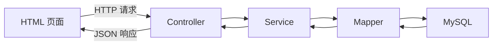

# SpringBoot 笔记目录与学习路线

> 本系列以 JDK 21、Spring Boot 4.x、MyBatis、MySQL 和用户管理案例为主。

## 1. 笔记目录

1. [[1、SpringBoot项目创建与HTTP请求响应]]  
   项目创建、HTTP、REST、Controller、请求参数和响应。

2. [[2、Spring三层架构、内聚与耦合、IoC与DI]]  
   Controller、Service、Dao 分工，IoC、DI、Bean 和构造器注入。

3. [[3、MyBatis知识点总结]]  
   Mapper、XML、CRUD、参数映射、动态 SQL、事务和缓存。

4. [[4、SpringBoot配置文件与日志]]  
   `yml` 与 `properties`、多环境配置、环境变量、日志级别和 SQL 日志。

5. [[5、Web接口工程化基础：DTO、校验、异常与跨域]]  
   DTO、参数校验、统一错误响应、全局异常处理和 CORS。

6. [[6、分页查询与PageHelper]]  
   `limit` 分页原理、PageHelper 使用方式、内部流程和常见问题。

## 2. 推荐学习顺序

```text
HTTP 请求与响应
    ↓
Controller 接收参数
    ↓
三层架构 + IoC/DI
    ↓
MyBatis 操作数据库
    ↓
配置与日志排错
    ↓
DTO + 参数校验 + 异常处理
    ↓
分页查询
```

## 3. 用户列表案例的完整调用链



各部分只做自己的工作：

| 部分 | 主要职责 |
|---|---|
| HTML | 发送请求、渲染数据 |
| Controller | 接收参数、返回响应 |
| Service | 业务规则、事务、分页入口 |
| Mapper | 执行 SQL、映射结果 |
| MySQL | 保存数据 |

## 4. 学习时重点区分

- `@Controller` 返回页面；`@RestController` 通常返回 JSON。
- IoC 是 Spring 管理对象；DI 是 Spring 把依赖传给对象。
- Mapper 是数据访问接口，不是 Service。
- `#{}` 是安全的预编译参数；`${}` 是字符串拼接。
- 参数格式校验放在 Controller 边界，业务规则放在 Service。
- 日志用于记录运行信息，不要使用 `System.out.println` 代替正式日志。
- 分页必须有稳定的 `order by`，否则翻页结果可能重复或遗漏。

> [!warning] 注意
> 学习项目可以简化，但不要把密码写入响应、日志或公开仓库。数据库密码建议使用环境变量。