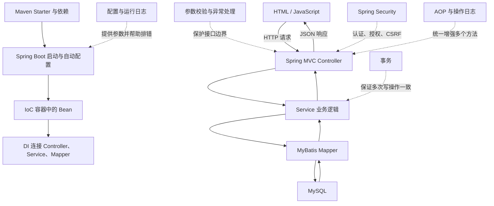
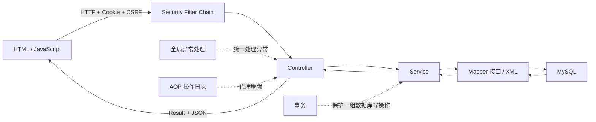

# Spring Boot 笔记目录与学习路线

## 本篇快速复习

- 学习主线是：**浏览器发请求 → Controller 接收 → Service 处理业务 → Mapper 操作数据库 → JSON 响应 → HTML 渲染**。
- Spring 用 IoC 容器管理 Bean，用 DI 连接 Bean；Spring Boot 再用 Starter 和自动配置减少环境搭建工作。
- MyBatis 负责 Java 方法与 SQL 之间的映射；事务负责保证一组数据库操作“要么都成功，要么都失败”。
- Cookie、Session、Spring Security 和 CSRF 共同解决登录状态与请求安全；BCrypt 只负责安全保存密码。
- AOP 适合日志、事务等横跨多个业务的公共功能；ThreadLocal 只保存当前线程的临时上下文。
- Maven 多模块是在代码量增大后，把 model、dao、service、web 的边界落实为真正的构建模块。
- 本系列以 **JDK 21、Spring Boot 4.0.7、MyBatis 和 `employee-management`** 为主要环境；旧的 txt 用户列表案例只用于理解最基本流程。

> [!tip] 使用方法
> 第一次学习按“推荐路线”顺序阅读；复习时先看每篇开头的“本篇快速复习”，遇到问题再跳到注意事项和问答。

---

## 1. 一张图看懂知识点关系



这张图可以概括整个项目：Maven 把所需代码带进项目，Spring Boot 创建运行环境，IoC/DI 组装对象，三层架构处理请求，MyBatis 访问数据库，事务和安全等能力在外层提供保障。

---

## 2. 笔记分类目录

### 第一阶段：先让 Web 程序跑起来

1. [[1、SpringBoot项目创建与HTTP请求响应]]<br>
   项目创建、静态 HTML、HTTP、REST、Controller、请求参数与 JSON 响应。

### 第二阶段：理解对象怎样分工和连接

2. [[2、Spring三层架构、内聚与耦合、IoC与DI]]<br>
   Controller、Service、Dao/Mapper 的职责，高内聚低耦合，Bean 与构造器注入。

### 第三阶段：连接数据库并完善接口

3. [[3、MyBatis知识点总结]]<br>
   Mapper、XML、CRUD、`@Param`、动态 SQL、结果映射、批量操作与主键回填。

4. [[4、SpringBoot配置文件与日志]]<br>
   YAML 与 properties、环境配置、日志级别、SQL 日志和排错方法。

5. [[5、Web接口工程化基础：DTO、校验、异常与跨域]]<br>
   DTO、参数校验、统一响应、业务异常、全局异常处理和 CORS。

6. [[6、分页查询与PageHelper]]<br>
   `limit` 原理、PageHelper 执行流程、`PageInfo` 与分页陷阱。

7. [[7、Spring事务与传播行为]]<br>
   事务的判断标准、`@Transactional`、回滚规则、代理失效和传播行为。

### 第四阶段：加入登录、安全和公共能力

8. [[8、登录认证与Spring Security：Session、Cookie、CSRF与BCrypt]]<br>
   登录流程、Session/Cookie、Spring Security、CSRF、BCrypt，以及和 JWT 的区别。

9. [[9、Spring AOP、操作日志与ThreadLocal]]<br>
   代理、切面、环绕通知、操作日志，以及 ThreadLocal 的用途和清理。

### 第五阶段：理解 Spring Boot 为什么能自动工作

10. [[10、Bean进阶：作用域、第三方Bean与Import]]<br>
    Bean 作用域、生命周期、第三方 Bean、`@Bean`、`@Import` 和注入细节。

11. [[11、SpringBoot起步依赖与自动配置]]<br>
    Starter、parent、BOM、条件装配、back-off 与启动过程。

### 第六阶段：把项目拆开、构建并验证

12. [[12、Maven高级与多模块项目]]<br>
    模块拆分、继承、聚合、依赖管理、依赖范围和私服概念。

13. [[13、employee-management项目测试与故障排查]]<br>
    当前四模块结构、单元/集成/API 测试、CRUD 检查和常见 `null`、启动、映射问题。

补充速查：[[附录、项目常用Java与SQL写法速查]]。

---

## 3. 推荐学习路线

```text
HTTP 与 Controller
        ↓
三层架构、IoC、DI
        ↓
MyBatis、配置、日志
        ↓
DTO、校验、异常、分页、事务
        ↓
Session 登录与 Spring Security
        ↓
AOP、ThreadLocal、Bean、自动配置
        ↓
Maven 多模块与项目测试
```

> [!important] 不要只背注解
> 每学一个注解，都要回答三个问题：它解决什么问题？应写在哪一层？它依赖 Spring 创建的代理或 Bean 吗？这样才能把零散知识连起来。

---

## 4. 三个案例如何逐步演进

| 阶段 | 数据来源与结构 | 主要学习目标 |
|---|---|---|
| `HelloSpring` 用户列表 | txt 文件、简单 HTML | 看懂请求、响应、JSON 与页面渲染 |
| `Springboot-mybatis` | MySQL、Mapper/XML | 学会 CRUD、参数绑定、动态 SQL |
| `employee-management` 单体阶段 | 员工、部门、班级、学生等模块 | 练习三层架构、分页、事务、异常、安全、AOP |
| `employee-management` 多模块阶段 | model、dao、service、web | 理解 Maven 模块边界、依赖方向与独立构建 |

旧案例不是“作废代码”，而是把复杂度分阶段加入：先看懂一次请求，再学习数据库和工程化能力。

---

## 5. 当前项目的完整调用链



| 部分 | 只负责什么 | 不应负责什么 |
|---|---|---|
| HTML / JavaScript | 发请求、展示数据、交互 | 可信的业务校验和数据库操作 |
| Controller | 接参数、调用 Service、组织 HTTP 响应 | 写 SQL、堆积业务规则 |
| Service | 业务规则、事务边界、组合多个 Mapper | 处理页面 DOM |
| Mapper / Dao | 执行 SQL、映射查询结果 | 决定业务流程 |
| 数据库 | 持久保存数据、约束数据 | 生成网页 |

---

## 6. 高频概念快速区分

| 容易混淆的概念 | 一句话区别 |
|---|---|
| `@Controller` / `@RestController` | 前者常配合模板返回视图；后者把返回值写入响应体，Java 对象通常转成 JSON |
| `@RequestParam` / `@PathVariable` / `@RequestBody` | 分别取查询/表单参数、URL 路径变量、JSON 请求体 |
| IoC / DI | IoC 是对象交给容器管理；DI 是容器把依赖传给对象 |
| Bean / 普通 `new` 对象 | Bean 受 Spring 管理，可获得注入、AOP、事务等能力；普通对象通常没有 |
| Starter / 自动配置 | Starter 带来一组依赖；自动配置根据条件创建默认 Bean |
| Mapper 接口 / Mapper XML | 接口定义 Java 方法；XML 提供对应 SQL 与映射规则 |
| `resultType` / `resultMap` | 前者适合直接映射；后者适合列名特殊、关联对象或一对多集合 |
| Cookie / Session | Cookie 在浏览器；Session 主要在服务器，Cookie 常保存其标识 `JSESSIONID` |
| CSRF / JWT / BCrypt | CSRF 防伪造请求；JWT 可承载认证声明；BCrypt 哈希密码，三者用途不同 |
| Filter / Interceptor / AOP | Filter 在 Servlet 边界；Interceptor 围绕 MVC Controller；AOP 围绕 Spring Bean 方法 |
| 日志 / 操作审计 | 运行日志帮助开发运维排错；操作审计记录谁在何时做了什么 |
| 继承 / 聚合 / 依赖 | Maven 继承共享配置；聚合统一构建模块；依赖表示代码使用另一个模块 |

---

## 7. 初学者最需要注意的原则

> [!warning] 安全
> 不要把明文密码写进数据库、JSON 响应、日志或 Git 仓库；配置中的数据库密码应通过环境变量或安全配置注入。

> [!warning] 数据一致性
> 一个业务动作需要连续修改多张表时，通常应在 Service 方法上设置事务。不要为了“看起来安全”给每个查询都随意加事务。

> [!warning] 代理边界
> `@Transactional` 和 Spring AOP 依赖代理。自己 `new` 对象、同一个类里用 `this` 调用被增强方法，常会绕过代理。

> [!warning] SQL
> 普通参数优先使用 `#{}`；`${}` 是文本拼接，若输入不可信会有 SQL 注入风险。分页必须使用稳定的 `order by`。

> [!warning] 时间与空值
> 前端不传时间时，Spring 和 MyBatis 不会自动替你使用当前时间。要在 Java 中显式调用 `LocalDateTime.now()`，或让数据库列设置默认值。

---

## 8. 学完后的自检

- [ ] 能从浏览器请求一路指出 Controller、Service、Mapper 和数据库的职责。
- [ ] 能根据参数位置选择 `@RequestParam`、`@PathVariable` 或 `@RequestBody`。
- [ ] 能解释为什么 Java 对象返回后是 JSON，而 `toString()` 不能代替 JSON 序列化。
- [ ] 能编写 Mapper 接口、XML CRUD、动态 SQL、结果映射和分页查询。
- [ ] 能判断一次业务是否需要事务，并说出默认传播行为 `REQUIRED` 的含义。
- [ ] 能解释 Session、Cookie、CSRF、JWT 和 BCrypt 各自解决的问题。
- [ ] 能解释构造器注入、单构造器省略 `@Autowired`，以及为什么 Spring 不会自动生成构造器。
- [ ] 能解释 Starter、自动配置、Bean、IoC、DI 之间的关系。
- [ ] 能说明当前四个 Maven 模块的依赖方向，并执行整个项目的测试与打包。

如果某一项答不出来，就回到对应专题先看“本篇快速复习”和“注意事项”，再运行项目中的实际代码验证。
