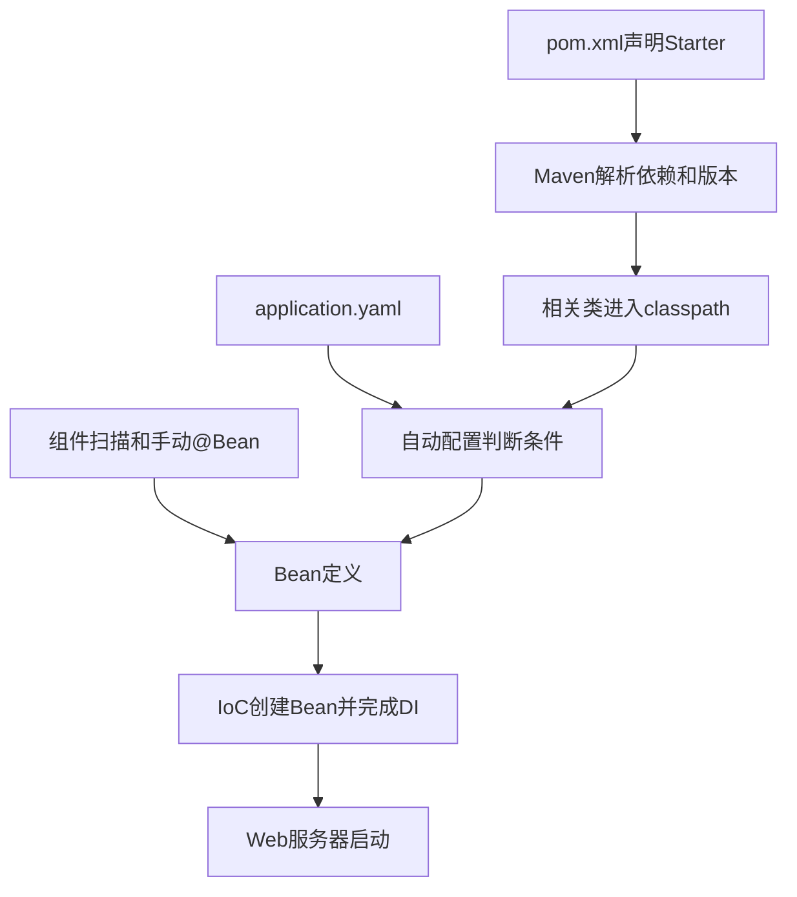

# Spring Boot 起步依赖与自动配置

## 本篇快速复习

- Starter 是经过搭配的依赖组合，可以理解为“依赖套餐”。
- BOM 和 `dependencyManagement` 统一依赖版本，但不会自动引入所有依赖。
- `spring-boot-starter-parent` 是 Maven 父 POM，提供依赖版本、属性和插件默认配置；它不是 Starter。
- Maven Plugin 在构建阶段工作，例如把 Web 模块打成可执行 JAR；它不是业务 Bean。
- `@SpringBootApplication` 主要组合配置类、自动配置和组件扫描三种能力。
- 自动配置根据 classpath、配置项、应用类型和已有 Bean 判断是否创建默认 Bean。
- 用户已提供合适 Bean 时，带 `@ConditionalOnMissingBean` 的默认配置通常会退让，这叫 back-off。
- Starter 负责“带来能力”，自动配置负责“按条件准备对象”，IoC 和 DI 负责“管理并连接对象”。
- 当前项目的 Web、Security、MyBatis、PageHelper 等能力来自不同 Starter，最终与业务 Bean 一起进入 IoC 容器。

> [!info] 学习环境
> JDK 21、Spring Boot 4.0.7、当前 `employee-management` 多模块项目。

---

## 1. 先把整条关系串起来

**结论：依赖先进入项目，自动配置再按条件注册 Bean，最后由 IoC 和 DI 组成可运行应用。**



| 机制 | 解决的问题 |
|---|---|
| Starter | 一次引入哪些依赖 |
| parent / BOM | 使用哪些兼容版本 |
| Plugin | Maven 怎样编译、测试、打包 |
| 组件扫描 | 找到自己编写的组件 |
| 自动配置 | 条件满足时提供哪些默认 Bean |
| 配置文件 | 默认对象使用哪些参数 |
| IoC / DI | 怎样管理并连接所有 Bean |

Bean 的注册和 `@Import` 详见 [[10、Bean进阶：作用域、第三方Bean与Import]]。

---

## 2. Starter：依赖套餐

**结论：Starter 主要是一份经过搭配的依赖描述，让我们不必逐个寻找相关 JAR。**

当前 Web 模块使用：

```xml
<dependency>
    <groupId>org.springframework.boot</groupId>
    <artifactId>spring-boot-starter-webmvc</artifactId>
</dependency>
```

它通过传递依赖带来开发 Spring MVC Web 应用需要的一组组件。当前项目还有：

| Starter | 主要用途 |
|---|---|
| `spring-boot-starter-security` | Spring Security |
| `spring-boot-starter-aspectj` | AOP 与 AspectJ 支持 |
| `mybatis-spring-boot-starter` | MyBatis 整合 |
| `pagehelper-spring-boot-starter` | PageHelper 整合 |

MyBatis 和 PageHelper Starter 是第三方项目提供的 Spring Boot 整合包。

### 传递依赖

```text
项目依赖A
A又依赖B和C
→ Maven通常也把B和C带进项目
```

查看实际依赖树：

```bash
mvn dependency:tree
```

### Starter 不等于自动配置

```text
Starter：让相关类进入classpath
自动配置：检查条件后决定是否创建Bean
```

> [!warning] Starter 不是业务代码生成器
> 引入 MyBatis Starter 不会替你编写 SQL；引入 Web Starter 也不会自动生成员工管理 Controller。

---

## 3. parent、BOM 与版本管理

**结论：parent 和 BOM 帮助项目使用一组经过协调的依赖版本。**

### Spring Boot parent

当前根 POM：

```xml
<parent>
    <groupId>org.springframework.boot</groupId>
    <artifactId>spring-boot-starter-parent</artifactId>
    <version>4.0.7</version>
    <relativePath/>
</parent>
```

它提供：

- Spring Boot 管理的依赖版本；
- 常用 Maven 属性；
- 编译、资源处理和插件的默认配置。

因此受管理依赖可以省略版本：

```xml
<dependency>
    <groupId>org.springframework.boot</groupId>
    <artifactId>spring-boot-starter-security</artifactId>
</dependency>
```

### BOM 与 `dependencyManagement`

BOM 是 `Bill of Materials`，可以理解为兼容版本清单。它通常通过 `dependencyManagement` 管理版本。

```text
dependencyManagement：规定“如果使用，应使用哪个版本”
dependencies：表示“当前模块真的要使用”
```

父 POM 中管理：

```xml
<dependencyManagement>
    <dependencies>
        <dependency>
            <groupId>org.mybatis.spring.boot</groupId>
            <artifactId>mybatis-spring-boot-starter</artifactId>
            <version>4.0.1</version>
        </dependency>
    </dependencies>
</dependencyManagement>
```

需要 MyBatis 的模块仍要真正声明：

```xml
<dependency>
    <groupId>org.mybatis.spring.boot</groupId>
    <artifactId>mybatis-spring-boot-starter</artifactId>
</dependency>
```

> [!warning] 不要随意覆盖受管理版本
> 单独升级底层 Spring、JSON 或服务器依赖可能破坏整套兼容关系。第三方 Starter 也要确认支持 Spring Boot 4.0.7。

---

## 4. Maven Plugin：构建工具

**结论：Plugin 在 Maven 构建阶段执行任务，不是注入业务代码的 Bean。**

只有可运行的 `employee-web` 使用：

```xml
<build>
    <plugins>
        <plugin>
            <groupId>org.springframework.boot</groupId>
            <artifactId>spring-boot-maven-plugin</artifactId>
        </plugin>
    </plugins>
</build>
```

它可以把应用重新打包成可执行 JAR：

```bash
java -jar employee-web/target/employee-web-0.0.1-SNAPSHOT.jar
```

| 名称 | 常见位置 | 核心作用 |
|---|---|---|
| Starter | `<dependencies>` | 引入一组依赖 |
| BOM | `<dependencyManagement>` | 统一依赖版本 |
| parent | `<parent>` | 继承依赖、属性和插件配置 |
| Plugin | `<build><plugins>` | 编译、测试、打包等任务 |

model、dao、service 是普通 JAR，没有启动类，不需要重新打成可执行 Boot JAR。

Maven 多模块详见 [[12、Maven高级与多模块项目]]。

---

## 5. `@SpringBootApplication` 的三部分

**结论：`@SpringBootApplication` 主要组合了配置类、自动配置和组件扫描。**

```java
@MapperScan("com.tanhong.mapper")
@SpringBootApplication
public class EmployeeManagementApplication {

    public static void main(String[] args) {
        SpringApplication.run(
                EmployeeManagementApplication.class,
                args
        );
    }
}
```

```text
@SpringBootApplication
├── @SpringBootConfiguration  主要配置类
├── @EnableAutoConfiguration  开启自动配置
└── @ComponentScan            扫描项目组件
```

`@ComponentScan` 默认扫描启动类所在包及其子包。`@EnableAutoConfiguration` 则从框架提供的候选配置中按条件选择。

> [!warning] 自动配置不等于组件扫描
> 自己的 Service 找不到，先检查扫描范围；数据源等基础设施没有创建，再检查依赖、配置项和自动配置条件。

### 为什么还需要 `@MapperScan`

Mapper 是接口，普通组件扫描不会自动编写实现。`@MapperScan` 通知 MyBatis 创建 Mapper 代理 Bean。

---

## 6. 自动配置如何工作

**结论：Spring Boot 先找到候选自动配置，再用条件筛选，而不是无条件创建所有对象。**

Spring Boot 4 的自动配置依赖通常声明类似资源：

```text
META-INF/spring/org.springframework.boot.autoconfigure.AutoConfiguration.imports
```

可以简化理解为：

```text
1. 依赖让类进入classpath
2. Spring Boot找到候选自动配置
3. 检查类、Bean、配置项和应用类型
4. 条件满足的配置注册Bean
5. 条件不满足的配置被跳过
```

旧教程可能使用 `spring.factories` 讲候选注册；学习 Spring Boot 4 时应以当前 imports 机制为准。

### 常见条件

| 条件注解 | 通俗含义 |
|---|---|
| `@ConditionalOnClass` | classpath 中存在某类时生效 |
| `@ConditionalOnBean` | 容器已有某 Bean 时生效 |
| `@ConditionalOnMissingBean` | 容器还没有某 Bean 时生效 |
| `@ConditionalOnProperty` | 配置项满足要求时生效 |
| `@ConditionalOnWebApplication` | 当前是 Web 应用时生效 |

简化示例：

```java
@AutoConfiguration
@ConditionalOnClass(SmsClient.class)
public class SmsAutoConfiguration {

    @Bean
    @ConditionalOnMissingBean
    public SmsClient smsClient() {
        return new SmsClient();
    }
}
```

只有存在 `SmsClient` 类，且容器中还没有对应 Bean 时，默认对象才会创建。

### 配置文件提供参数

```yaml
spring:
  datasource:
    url: jdbc:mysql://localhost:3306/tlias
    username: root
    password: ${DB_PASSWORD}
```

依赖决定能力是否存在，配置文件提供连接参数，自动配置据此准备数据源相关 Bean。

---

## 7. back-off：默认配置退让

**结论：很多自动配置只在用户没有提供对应 Bean 时给出默认实现。**

如果默认配置带有：

```java
@Bean
@ConditionalOnMissingBean
public SmsClient smsClient() {
    return new DefaultSmsClient();
}
```

而用户已经提供：

```java
@Bean
public SmsClient smsClient() {
    return new CustomSmsClient();
}
```

默认 Bean 会退让。可以理解为：

> Spring Boot 提供合理默认值，但尊重用户的明确配置。

> [!warning] back-off 取决于具体条件
> 并非任何“看起来相似”的对象都能覆盖默认配置。应检查条件使用的是类型、名称还是配置项。

---

## 8. 当前项目中的完整体现

**结论：当前项目正是由依赖、配置、扫描、手动 Bean 和自动配置共同启动。**

| 阶段 | 当前项目中的体现 |
|---|---|
| 版本管理 | 根 POM 继承 Boot 4.0.7 parent，并管理第三方版本 |
| 引入能力 | Web 模块引入 Web MVC、Security、AOP、MyBatis、PageHelper、MySQL 驱动 |
| 组件扫描 | 找到 Controller、Service、切面和配置类 |
| Mapper 扫描 | MyBatis 创建 Mapper 代理 Bean |
| 配置参数 | `application.yaml` 提供数据源、MyBatis、分页、Session 等参数 |
| 手动配置 | `SecurityConfig` 提供 `PasswordEncoder` 和 `SecurityFilterChain` |
| 自动配置 | 准备 MVC、服务器、JSON、数据源、MyBatis、事务等基础设施 |
| DI | 把 Controller、Service、Mapper 和基础设施连接起来 |

最终调用关系：

```text
Controller
  → Service
  → MyBatis Mapper代理
  → SqlSession / DataSource
  → MySQL
```

自动配置不会替代员工、班级和学生的业务规则，也不会自动编写 Mapper SQL。

---

## 9. 查看自动配置条件

**结论：遇到问题应查看条件报告，不要靠反复增删注解猜测。**

```bash
java -jar employee-web/target/employee-web-0.0.1-SNAPSHOT.jar --debug
```

也可以临时配置：

```yaml
debug: true
```

日志会显示哪些配置匹配、哪些没有匹配以及失败条件。排错后通常关闭 debug。

确实不需要某项自动配置时可以排除：

```java
@SpringBootApplication(exclude = SomeAutoConfiguration.class)
```

> [!warning] 不要用排除掩盖错误
> 当前项目需要 MySQL 和 MyBatis，不能为了消除启动报错而随意排除数据源配置。

---

## 10. 常见问答

### 问：有 Starter 为什么还要写 `application.yaml`？

Starter 带来能力，但数据库地址、账号、Session 超时等项目参数无法由框架猜出。

### 问：写进 `dependencyManagement` 后为什么仍不能使用？

它只规定版本。需要使用的模块仍要在 `<dependencies>` 中声明。

### 问：为什么有些依赖不写版本？

因为 parent、BOM 或当前父 POM已经管理版本；没有版本管理时不能随意省略。

### 问：自己定义 Bean 后，默认 Bean 为什么没创建？

很多自动配置使用 `@ConditionalOnMissingBean`，检测到用户 Bean 后会退让。

### 问：为什么 Mapper 没有实现类也能注入？

`@MapperScan` 让 MyBatis 创建接口代理 Bean，不是普通组件扫描生成实现。

### 问：`@Import` 和自动配置有什么关系？

自动配置的启用使用了 Spring 的导入和选择机制，但日常由 `@EnableAutoConfiguration` 触发。`@Import` 本身不下载依赖，也不等于 Starter。

---

## 11. 最终检查

**结论：排错时沿着“依赖 → 版本 → 配置 → 条件 → Bean”逐层检查。**

- [ ] Starter 和第三方组件是否与 Spring Boot 4.0.7 兼容？
- [ ] 依赖是否真正写入当前模块的 `<dependencies>`？
- [ ] 配置项名称、层级和环境变量是否正确？
- [ ] 自己的组件是否在扫描范围？
- [ ] Mapper 是否被 `@MapperScan` 扫描？
- [ ] 是否存在用户 Bean 导致默认配置退让？
- [ ] 是否查看过 debug 条件报告？
- [ ] 是否避免用排除配置掩盖真正错误？

---

## 一句话总结

> Starter 把一组依赖带进 classpath，parent 和 BOM 保证版本协调，Plugin 负责构建；`@SpringBootApplication` 开启配置、扫描和自动配置，自动配置再根据条件提供默认 Bean，并在用户提供合适 Bean 时按条件退让。

---

## 继续学习

- [[10、Bean进阶：作用域、第三方Bean与Import]]
- [[4、SpringBoot配置文件与日志]]
- [[12、Maven高级与多模块项目]]
- [[0、SpringBoot笔记目录与学习路线|返回笔记目录]]
