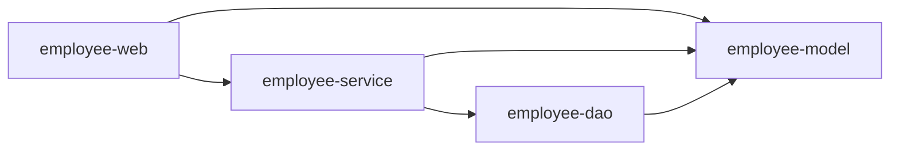
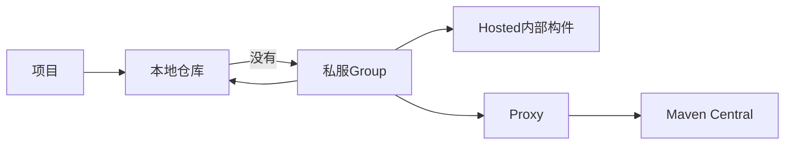

# Maven 高级与多模块项目

## 本篇快速复习

- Java 包用于整理类；Maven 模块是带独立 `pom.xml` 的构建单元。
- 继承通过 `<parent>` 复用父 POM；聚合通过 `<modules>` 一次构建多个模块。
- 模块要使用另一个模块的类，必须声明 `<dependency>`；聚合不会自动产生代码依赖。
- `dependencyManagement` 只统一版本，真正使用仍要写入 `<dependencies>`。
- Maven Reactor 分析模块依赖并安排构建顺序。
- `package` 生成构件，`install` 放入本地仓库，`deploy` 上传远程仓库。
- 私服中 hosted 保存团队产物，proxy 代理外部仓库，group 提供统一入口。
- `settings.xml` 主要配置镜像和认证，`distributionManagement` 指定发布目标。
- 当前项目有 model、dao、service、web 四个模块，依赖必须保持单向。
- 只有 `employee-web` 是可直接运行的 Spring Boot 应用；根工程只负责管理和聚合。

> [!info] 学习环境
> JDK 21、Spring Boot 4.0.7、当前 `employee-management` 项目。

---

## 1. 包、模块与坐标

**结论：包是 Java 代码组织方式，模块是 Maven 的构建和依赖边界。**

| 对比 | Java 包 | Maven 模块 |
|---|---|---|
| 标志 | `package com.tanhong...` | 独立 `pom.xml` |
| 作用 | 整理类、避免重名 | 声明依赖、编译、测试、打包 |
| 独立构件 | 通常不是 | 可以生成 JAR 或 POM |
| 示例 | `com.tanhong.service` | `employee-service` |

不同模块仍可使用统一根包：

```text
employee-web       com.tanhong.controller
employee-service   com.tanhong.service
employee-dao       com.tanhong.mapper
employee-model     com.tanhong.pojo
```

这样从 `com.tanhong` 开始组件扫描时，也能发现依赖模块 JAR 中的组件。

### Maven 坐标

```xml
<groupId>com.tanhong</groupId>
<artifactId>employee-management</artifactId>
<version>0.0.1-SNAPSHOT</version>
<packaging>pom</packaging>
```

```text
groupId + artifactId + version = 构件坐标
```

- `groupId`：组织或项目组；
- `artifactId`：构件名称；
- `version`：版本；
- `packaging`：打包类型。

根工程使用 `pom`，表示主要管理配置和模块；子模块默认使用 `jar`。

> [!warning] 不要为了“高级”而过度拆分
> 模块越多，POM、资源扫描和构建关系越复杂。模块应对应真实职责或复用边界。

---

## 2. 当前四模块结构

**结论：当前项目按模型、数据访问、业务和 Web 应用建立了单向边界。**

```text
employee-management
├─ pom.xml                 父工程 + 聚合工程
├─ database                数据库脚本
├─ employee-model          实体、查询参数、统一结果
├─ employee-dao            Mapper接口和XML
├─ employee-service        业务逻辑、事务、业务异常
└─ employee-web            Controller、安全、配置、启动类和前端
```



| 模块 | 主要内容 | 可独立启动 |
|---|---|---|
| `employee-model` | `Emp`、`Student`、查询参数、`Result` | 否 |
| `employee-dao` | Mapper 接口和 XML | 否 |
| `employee-service` | Service、事务、业务异常 | 否 |
| `employee-web` | Controller、Security、AOP、配置和静态页面 | 是 |

Web 直接依赖 model，是因为 Controller 的请求参数和响应会使用模型类型。只有 `employee-web` 有启动类和 Spring Boot Maven Plugin。

---

## 3. 继承、聚合与依赖

**结论：继承复用配置，聚合统一构建，依赖决定能否使用代码。**

### 3.1 继承

根 POM 继承 Spring Boot parent：

```xml
<parent>
    <groupId>org.springframework.boot</groupId>
    <artifactId>spring-boot-starter-parent</artifactId>
    <version>4.0.7</version>
    <relativePath/>
</parent>
```

`<relativePath/>` 表示按仓库坐标解析父 POM，不从项目上级目录查找。

子模块继承当前根 POM：

```xml
<parent>
    <groupId>com.tanhong</groupId>
    <artifactId>employee-management</artifactId>
    <version>0.0.1-SNAPSHOT</version>
    <relativePath>../pom.xml</relativePath>
</parent>

<artifactId>employee-dao</artifactId>
```

子模块可以继承 `groupId`、`version`、属性、依赖版本和插件配置，但必须有自己的 `artifactId`。

查看合并后的有效 POM：

```bash
mvn help:effective-pom
```

### 3.2 聚合

根 POM：

```xml
<packaging>pom</packaging>

<modules>
    <module>employee-model</module>
    <module>employee-dao</module>
    <module>employee-service</module>
    <module>employee-web</module>
</modules>
```

从根目录执行一次 `mvn package`，四个模块会进入同一次 Reactor 构建。

父工程和聚合工程不是同一概念，但当前根 POM 同时承担两种职责：

```text
父工程：被子模块通过<parent>继承
聚合工程：通过<modules>收集子模块
```

### 3.3 依赖

`employee-dao` 使用 `employee-model`：

```xml
<dependency>
    <groupId>com.tanhong</groupId>
    <artifactId>employee-model</artifactId>
</dependency>
```

写进 `<modules>` 只表示一起构建，不能代替 `<dependency>`。

依赖必须避免循环：

```text
正确：web → service → dao → model
错误：service → dao → service
```

> [!note] 传递依赖
> Web 可能通过 Service 间接看到 Dao，但如果 Web 直接调用 Dao，就应显式声明依赖或重构掉跨层调用。当前项目已让登录认证和操作日志通过 Service 访问 Mapper。

---

## 4. `dependencyManagement` 与 `dependencies`

**结论：前者统一版本，后者真正把依赖加入模块。**

父 POM 管理内部模块版本：

```xml
<dependencyManagement>
    <dependencies>
        <dependency>
            <groupId>com.tanhong</groupId>
            <artifactId>employee-model</artifactId>
            <version>${project.version}</version>
        </dependency>
    </dependencies>
</dependencyManagement>
```

子模块真正使用：

```xml
<dependency>
    <groupId>com.tanhong</groupId>
    <artifactId>employee-model</artifactId>
</dependency>
```

版本由父 POM 管理，所以可以省略。

| 标签 | 真正引入依赖 | 作用 |
|---|---|---|
| `<dependencies>` | 是 | 当前模块使用依赖 |
| `<dependencyManagement>` | 否 | 统一版本和默认参数 |

父 POM 不应在 `<dependencies>` 中无条件引入全部 Web、Security、数据库依赖，否则每个子模块都会变重。推荐：

```text
父POM dependencyManagement：统一版本
子模块 dependencies：按职责引入
```

插件也类似：

```text
pluginManagement：统一插件版本和默认配置
plugins：当前模块真正应用插件
```

---

## 5. Maven Reactor 与常用命令

**结论：Reactor 收集本次构建模块，并根据依赖图安排正确顺序。**

当前大致顺序：

```text
employee-model → employee-dao → employee-service → employee-web
```

常用命令：

| 目的 | 命令 |
|---|---|
| 构建全部模块 | `mvn clean package` |
| 运行全部测试 | `mvn clean test` |
| 构建 Web 及其依赖 | `mvn -pl :employee-web -am package` |
| 测试 model 及下游模块 | `mvn -pl :employee-model -amd test` |
| 从失败模块继续 | `mvn -rf :employee-service package` |
| 临时跳过测试执行 | `mvn package -DskipTests` |

参数含义：

```text
-pl   选择模块
-am   同时构建它依赖的上游模块
-amd  同时构建依赖它的下游模块
-rf   从指定模块恢复构建
```

> [!warning] 正式交付前不要长期跳过测试
> 修改事务、安全或 Mapper XML 后，应从根目录运行完整测试。

---

## 6. `package`、`install` 与 `deploy`

**结论：三个阶段的主要区别是构建产物最终放到哪里。**

```text
compile → test → package → verify → install → deploy
```

执行后面的阶段会先执行前面的阶段。

| 命令 | 结果位置 | 用途 |
|---|---|---|
| `mvn package` | 当前模块的 `target` | 生成 JAR |
| `mvn install` | 本地 `.m2/repository` | 供本机其他项目使用 |
| `mvn deploy` | 远程私服 | 供团队和 CI 使用 |

`clean` 属于单独的清理生命周期：

```bash
mvn clean package
```

表示先清理旧 `target`，再重新构建到 package。

### SNAPSHOT 与正式版本

```text
1.0.0-SNAPSHOT   开发版本，可以继续变化
1.0.0            正式版本，发布后不应覆盖
```

推荐：

```text
开发 1.0.0-SNAPSHOT → 发布 1.0.0 → 继续开发 1.0.1-SNAPSHOT
```

---

## 7. Maven 仓库与私服

**结论：仓库保存 Maven 构件，私服让团队统一共享、代理和管理依赖。**

| 仓库 | 作用 |
|---|---|
| 本地仓库 | 缓存下载内容和 `install` 结果 |
| 中央仓库 | 提供 Spring、MyBatis 等公开依赖 |
| 私服 | 保存内部构件、代理外部仓库并控制权限 |

Windows 默认本地仓库通常是：

```text
C:\Users\用户名\.m2\repository
```

常见私服软件有 Nexus Repository 和 JFrog Artifactory。

### hosted、proxy 与 group

| 类型 | 作用 | 示例 |
|---|---|---|
| hosted | 保存团队上传的构件 | releases、snapshots |
| proxy | 代理并缓存外部仓库 | Maven Central 代理 |
| group | 合并多个仓库为统一入口 | maven-public |



私服可以避免手工发送 JAR、统一版本来源，并让 CI 稳定获取内部依赖。

> [!note] Git 与私服不同
> Git 保存源码和历史；Maven 私服保存编译后的 JAR、POM 和版本元数据。

---

## 8. `settings.xml`：镜像和认证

**结论：`settings.xml` 保存当前开发环境的仓库入口与凭据，真实密码不应写入项目 POM。**

用户级文件通常位于：

```text
C:\Users\用户名\.m2\settings.xml
```

```xml
<settings>
    <mirrors>
        <mirror>
            <id>company-public</id>
            <mirrorOf>external:*</mirrorOf>
            <url>
                https://maven.example.com/repository/maven-public/
            </url>
        </mirror>
    </mirrors>

    <servers>
        <server>
            <id>company-public</id>
            <username>${env.MAVEN_REPO_USER}</username>
            <password>${env.MAVEN_REPO_PASSWORD}</password>
        </server>
        <server>
            <id>company-releases</id>
            <username>${env.MAVEN_REPO_USER}</username>
            <password>${env.MAVEN_REPO_PASSWORD}</password>
        </server>
        <server>
            <id>company-snapshots</id>
            <username>${env.MAVEN_REPO_USER}</username>
            <password>${env.MAVEN_REPO_PASSWORD}</password>
        </server>
    </servers>
</settings>
```

- `<mirror>`：把匹配的下载请求转向私服；
- `<server>`：为相同 `id` 的仓库提供认证；
- `${env.X}`：从环境变量读取敏感信息。

> [!warning] 不要提交密码
> POM 会进入 Git，不能保存私服密码。正式团队还可使用 Maven 密码加密和 CI 密钥管理。

---

## 9. `distributionManagement`：发布目标

**结论：`distributionManagement` 指定 deploy 到哪里，`settings.xml` 提供账号。**

父 POM 示例：

```xml
<distributionManagement>
    <repository>
        <id>company-releases</id>
        <url>
            https://maven.example.com/repository/maven-releases/
        </url>
    </repository>
    <snapshotRepository>
        <id>company-snapshots</id>
        <url>
            https://maven.example.com/repository/maven-snapshots/
        </url>
    </snapshotRepository>
</distributionManagement>
```

发布：

```bash
mvn clean deploy
```

```text
1.0.0-SNAPSHOT → snapshotRepository
1.0.0          → repository
```

`distributionManagement` 中的仓库 `id` 必须与 `settings.xml` 的 `<server>` `id` 对应，否则 Maven 找不到认证信息。

| 配置 | 方向 | 作用 |
|---|---|---|
| `mirror` | 下载 | 指定统一下载入口 |
| `distributionManagement` | 上传 | 指定 deploy 目标 |
| `servers` | 认证 | 为同 ID 仓库提供凭据 |

> [!warning] 学习项目不要随意 deploy
> 只有获得仓库地址、权限和发布规则后才执行。正式版本发布属于团队外部状态变更。

---

## 10. 当前项目怎样完成拆分

**结论：一次抽出一个模块，每一步重新构建，比一次搬完所有代码更容易排错。**

### 第一步：确认单模块基线

```bash
mvn clean test
mvn clean package
```

先确认原项目正常，避免把旧错误误认为拆分错误。

### 第二步：建立根 POM 和 Web 模块

先把原 `src` 整体放入 `employee-web`，根 POM 改为 `pom` 打包并聚合子模块。此时先保证 Web 仍能运行。

### 第三步：抽出 model

移动实体、查询参数和统一结果，尽量保留原包名 `com.tanhong.pojo`，减少 import 和 Mapper XML 同时变化。

### 第四步：抽出 dao

移动 Mapper 接口与 XML。XML 放在：

```text
employee-dao/src/main/resources/com/tanhong/mapper
```

跨模块查找 XML：

```yaml
mybatis:
  mapper-locations: classpath*:/com/tanhong/mapper/*.xml
```

`classpath*:` 可以查找依赖模块 JAR 中的资源，同时保留：

```java
@MapperScan("com.tanhong.mapper")
```

### 第五步：抽出 service

移动 Service、事务和业务异常。Service 可以依赖 Dao 和 Model，但不能依赖 Web。

### 第六步：消除 Web 直连 Mapper

```text
EmpUserDetailsService → EmpService → EmpMapper
OperationLogAspect → OperateLogService → OperateLogMapper
```

这样 Web 不再直接依赖 DAO。

### 第七步：验证

每一步从根目录运行测试和打包，并检查登录、CRUD、Mapper XML、分页、事务、AOP 日志和静态页面。

---

## 11. 常见问题与坑

**结论：多模块错误通常来自依赖、资源、扫描或启动入口。**

| 问题 | 原因与处理 |
|---|---|
| 根工程不能运行 | 根 POM 是 `pom`，应运行 Web 模块启动类 |
| `<modules>` 写了仍找不到类 | 聚合不等于依赖，使用方需添加 `<dependency>` |
| 写入 `dependencyManagement` 仍不能 import | 它只管版本，当前模块仍需声明依赖 |
| 单独构建 Web 找不到 Service | 从根目录使用 `-pl :employee-web -am`，或先 `install` |
| Mapper XML 找不到 | 检查 resources 位置、namespace 和 `classpath*:` |
| Service 扫描不到 | 检查 Web 是否依赖 Service、实现类注解和根包范围 |
| 所有模块都配置 Boot Plugin | 只让有启动类的 Web 模块应用插件 |
| 出现循环依赖 | 重新划分职责，不能让 Dao 反向依赖 Service |
| IDEA 红色但 Maven 构建正常 | Reload All Maven Projects |
| 拆分后出现重复类 | 确认旧根 `src` 没有和新模块源码同时参与构建 |

Mapper XML 还应检查：

- `namespace` 是否等于 Mapper 接口全限定名；
- XML 是否实际进入 DAO JAR；
- `application.yaml` 是否位于 Web 模块。

> [!warning] 构建成功不等于功能全部正常
> 模块拆分会影响资源、扫描和代理，应继续测试登录、安全、分页、事务和增删改查。

---

## 12. 常见问答

### 问：继承、聚合和依赖怎么区分？

```text
继承：复用父POM配置
聚合：一次构建多个模块
依赖：真正使用另一个模块的代码
```

### 问：为什么子模块不写 `groupId` 和 `version`？

它们从根父 POM 继承；`artifactId` 必须保留以区分模块。

### 问：为什么 Maven 不完全按 `<modules>` 顺序构建？

Reactor 会根据依赖图调整顺序，让被依赖模块先构建。

### 问：`package` 后为什么另一个独立项目找不到 JAR？

`package` 只把 JAR 放到当前 `target`。供本机其他项目使用要 `install`，供团队使用通常要发布私服。

### 问：私服账号正确为什么仍然 401？

检查仓库 `id` 是否与 `settings.xml` 中 `<server>` 的 `id` 完全一致，并确认账号拥有目标仓库权限。

### 问：学习项目必须搭建私服吗？

不必须。先理解本地仓库、中央仓库、`install` 和 `deploy` 即可，多人共享内部 JAR 时再搭建。

### 问：需要再建 `employee-common` 吗？

只有出现多个模块稳定复用且职责清晰的公共能力时再建，不要把无处安放的类都塞进 common。

---

## 13. 最终检查

**结论：模块化完成的标准是职责清楚、依赖单向，并能从根目录完整构建。**

- [ ] 根 POM 是否为 `pom` 并聚合四个模块？
- [ ] 子模块是否正确继承根 POM？
- [ ] `dependencyManagement` 是否只管理版本？
- [ ] 每个模块是否只引入实际需要的依赖？
- [ ] 依赖是否单向且没有循环？
- [ ] Web 是否通过 Service 访问数据层？
- [ ] Mapper XML、`classpath*:` 和 `@MapperScan` 是否正确？
- [ ] 是否只有 Web 模块应用 Boot Plugin？
- [ ] 是否能从根目录通过 `mvn clean test` 和 `mvn clean package`？
- [ ] 私服凭据是否未写入 POM 或 Git？
- [ ] 发布仓库 ID 是否与 `settings.xml` 的服务器 ID 一致？

---

## 一句话总结

> Maven 模块用独立 POM 建立边界，继承复用配置，聚合统一构建，依赖表达代码关系，Reactor 安排顺序；`package`、`install`、`deploy` 分别把产物放到目标目录、本地仓库和私服，私服再通过 hosted、proxy、group 统一管理依赖。

---

## 继续学习

- [[10、Bean进阶：作用域、第三方Bean与Import]]
- [[11、SpringBoot起步依赖与自动配置]]
- [[3、MyBatis知识点总结]]
- [[4、SpringBoot配置文件与日志]]
- [[0、SpringBoot笔记目录与学习路线|返回笔记目录]]
