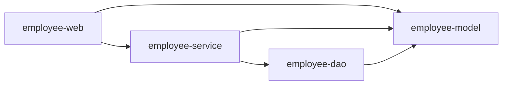
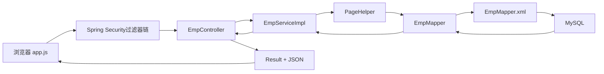
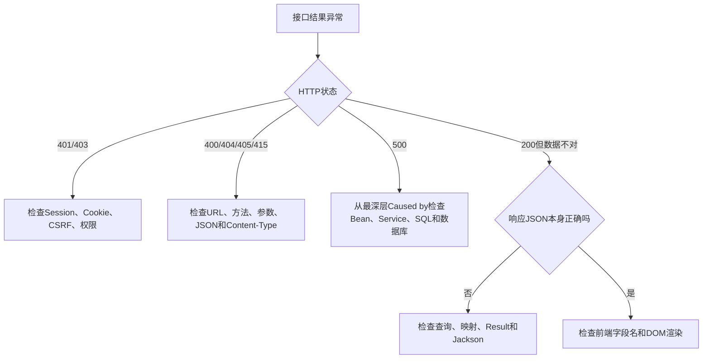

# employee-management 项目测试与故障排查

## 本篇快速复习

- 当前项目是 Maven 多模块结构，只有 `employee-web` 是可直接启动的 Spring Boot 应用。
- 一次业务请求通常经过：Security Filter → Controller → Service → Mapper → MySQL。
- 单元测试只测试一个类；集成测试会启动部分或完整 Spring 容器；接口测试从 HTTP 角度验证请求与响应。
- `@SpringBootTest` 启动完整上下文，MockMvc 可以在不真正监听端口的情况下测试 MVC 和安全过滤器链。
- `@MockitoBean` 用模拟 Bean 替换真实 Bean，适合避免测试时连接或修改本地数据库。
- 排错不要只看“服务器异常”，应依次检查 HTTP 状态码、异常第一条 `Caused by`、SQL、参数和映射。
- 字段为 `null` 不一定是数据库没有值，也可能是 SQL 没查、别名不匹配、XML 没封装或响应方法没传数据。
- 整理本笔记时的项目基线是：JDK 21、Spring Boot 4.0.7，`mvn clean package` 成功，10 个测试通过。

> [!note] 本篇定位
> 前面的笔记分别解释单个技术；本篇把它们放回当前项目的完整调用链中，并提供一套固定排错顺序。

---

## 1. 当前项目结构

先记住：父工程负责聚合，四个子模块负责不同职责。

```text
employee-management/
├── pom.xml                  父POM、依赖版本、聚合模块
├── database/                数据库迁移脚本
├── employee-model/          Emp、Clazz、Student、Result等模型
├── employee-dao/            Mapper接口和Mapper XML
├── employee-service/        业务规则、事务和业务异常
└── employee-web/            启动类、Controller、Security、AOP、页面
```

依赖方向：



这表示 Web 通过 Service 处理业务，同时直接使用请求/响应模型；Service 使用 Dao 和 Model；Dao 使用 Model。依赖保持单向，不能让 Dao 反向依赖 Service。

> [!warning] 只能运行 Web 模块
> 根工程的 `packaging` 是 `pom`，没有启动类；`model`、`dao`、`service` 是普通 JAR。应运行 `employee-web` 中的 `EmployeeManagementApplication`。

---

## 2. 一次请求经过哪些部分

以“分页查询员工”为例：



各部分出现问题时的典型表现：

| 位置 | 常见问题 | 表现 |
|---|---|---|
| 浏览器 | URL、请求方法、CSRF 头错误 | 404、405、403 |
| Controller | 参数绑定失败 | 400 |
| Service | 业务异常、事务问题 | 400、409、500 |
| Mapper/XML | SQL 或映射错误 | 500、字段为 `null` |
| 数据库 | 约束、连接、表结构问题 | 500、SQL 异常 |
| Jackson/Result | 响应封装错误 | `data:null`、字段缺失 |

---

## 3. 三种测试先分清

先记住：测试范围越大，越接近真实运行，但执行更慢、失败原因也更多。

### 3.1 单元测试

只测试一个类，把它依赖的对象全部模拟掉。

例如测试 `EmpServiceImpl`：

```java
@ExtendWith(MockitoExtension.class)
class EmpServiceImplTests {

    @Mock
    private EmpMapper empMapper;

    @Mock
    private EmpExprMapper empExprMapper;

    @Mock
    private PasswordEncoder passwordEncoder;

    @InjectMocks
    private EmpServiceImpl empService;
}
```

适合验证：

- 业务判断。
- Mapper 是否按预期调用。
- 事务以外的 Java 逻辑。
- 异常是否正确抛出。

### 3.2 Spring 集成测试

```java
@SpringBootTest
class EmployeeManagementApplicationTests {

    @Test
    void contextLoads() {
    }
}
```

它会检查：

- POM 依赖是否完整。
- Bean 是否能创建和注入。
- 配置是否能加载。
- Mapper、Security、AOP 是否能装配。

### 3.3 MockMvc 接口测试

```java
@SpringBootTest
@AutoConfigureMockMvc
class SecurityIntegrationTests {

    @Autowired
    private MockMvc mockMvc;
}
```

MockMvc 会模拟 HTTP 请求，但不需要真的启动 8080 端口。

```java
mockMvc.perform(get("/auth/csrf"))
        .andExpect(status().isOk())
        .andExpect(jsonPath("$.code").value(1));
```

它可以验证：

- URL 和 HTTP 方法。
- JSON 请求与响应。
- Session 登录状态。
- CSRF。
- Spring Security 过滤器链。
- Controller、全局异常和 AOP。

---

## 4. 为什么使用 `@MockitoBean`

先记住：它把 Spring 容器里的真实 Bean 替换成 Mockito 模拟对象。

```java
@MockitoBean
private EmpService empService;

@MockitoBean
private OperateLogService operateLogService;
```

这样测试新增员工接口时：

- 不会真的向 `emp` 表插入数据。
- 不会真的向 `operate_log` 表写日志。
- 仍然可以验证 Controller、Security 和 AOP 是否执行。

```java
verify(operateLogService).save(logCaptor.capture());
```

> [!warning] 模拟测试的边界
> Mapper 被模拟后，测试不能证明 SQL 一定正确。SQL 还需要 Mapper 集成测试或连接专用测试数据库验证。

---

## 5. CRUD 功能应该怎样测试

先记住：增删改测试会改变数据库，必须使用测试数据和明确的清理策略。

### 5.1 新增

至少检查：

1. 响应是否成功。
2. 员工基本信息是否插入。
3. `id` 是否回填。
4. 工作经历的 `emp_id` 是否等于新员工 ID。
5. 密码是否已经 BCrypt 哈希，而不是明文。
6. 中途失败时基本信息和工作经历是否一起回滚。

### 5.2 查询

至少检查：

- 基本字段是否正确。
- `deptName` 是否来自部门联表。
- `exprList` 是否由 `<collection>` 封装。
- 密码是否没有出现在 JSON 中。
- 分页的 `total` 和 `rows/list` 是否正确。

### 5.3 修改

当前工作经历采用“全量覆盖”：

```text
更新员工基本信息
→ 删除该员工所有旧经历
→ 插入请求中的新经历列表
```

需要验证整个过程位于同一事务中。这个方案简单可靠，但即使只增加一条经历，也会删除后重插全部经历。数据量变大后可以改成按经历 ID 增删改。

### 5.4 删除

至少检查：

- 批量员工删除是否同时处理工作经历。
- 删除班级前是否检查学生数量。
- 有学生时是否抛出 `ClazzHasStudentsException`。
- 拒绝删除时数据库是否保持不变。

> [!danger] 测试数据库
> 不要让删除和修改测试连接生产数据库。可以使用专用测试库、测试事务回滚，或者在测试中模拟 Mapper。

---

## 6. HTTP 状态码快速排错

| 状态码 | 先检查什么 |
|---:|---|
| `400` | 参数缺失、类型、JSON 格式、DTO 校验、业务参数 |
| `401` | 是否登录、Session 是否过期、JSESSIONID 是否携带 |
| `403` | CSRF 令牌、权限、安全配置 |
| `404` | URL、Controller 扫描、静态资源路径 |
| `405` | GET/POST/PUT/DELETE 是否和映射一致 |
| `409` | 唯一键冲突、班级仍有学生等业务冲突 |
| `415` | `Content-Type` 是否正确 |
| `500` | 服务端异常、SQL、Bean 装配、空指针 |

固定排错顺序：

```text
请求方法和URL
→ 状态码和响应体
→ 控制台第一条异常
→ 最深层 Caused by
→ MyBatis SQL和参数
→ 数据库真实数据
```

再按现象分流，可以更快定位：



---

## 7. 常见 `null` 问题

先记住：字段为 `null` 要沿着“请求 → Java → SQL → 映射 → 响应”逐段检查。

| 字段 | 可能是合法空值吗 | 常见错误位置 | 第一项检查 |
|---|---|---|---|
| `Result.data` | 无返回数据的成功操作可以为空 | 统一响应重载 | 是否调用了 `success(data)` |
| `exprList` | 没有经历时应为空集合；返回 `null` 往往需继续排查 | JOIN、`collection`、查询方法 | 是否调用详情查询并使用对应 `resultMap` |
| `deptName` | 员工确实没有部门时可以为空 | 外键、JOIN、别名、映射 | `dept_id` 是否有匹配部门 |
| `createTime/updateTime` | 新增后的正式数据通常不应为空 | Java 赋值、INSERT、SELECT | INSERT 是否包含时间列 |
| `EmpExpr.empId` | 已保存的经历通常不应为空 | 主键回填、子表赋值、结果映射 | 新增后是否执行 `expr.setEmpId(emp.getId())` |

> [!tip] 空集合与映射失败要区分
> “员工没有任何工作经历”是正常业务结果，接口最好返回 `[]`；数据库明明有经历却得到 `null` 或 `[]`，才应继续检查 JOIN、别名和 `resultMap`。

### 7.1 `Result.data` 为 `null`

```java
Result.success();       // 没有数据
Result.success(emp);    // 携带员工对象
```

检查有参重载是否真的赋值给 `data`。

### 7.2 `exprList` 为 `null`

成功向 `emp_expr` 插入数据，不代表查询员工时会自动加载经历。

需要：

```text
LEFT JOIN emp_expr
+ resultMap
+ collection property="exprList"
```

### 7.3 `deptName` 为 `null`

依次检查：

1. `emp.dept_id` 是否有值。
2. 部门表是否存在对应 ID。
3. JOIN 条件是否正确。
4. SQL 是否写了 `d.name AS deptName` 或对应 `resultMap`。
5. Java 是否真的有 `deptName` 属性和 setter。

### 7.4 `createTime`、`updateTime` 为 `null`

即使 Java 已调用：

```java
clazz.setCreateTime(LocalDateTime.now());
```

如果 INSERT SQL 没有包含 `create_time` 列，它仍不会写入数据库。还要检查对象是否是同一个、SQL 参数名是否正确、查询 SQL 是否把时间字段查出来。

### 7.5 `empId` 为 `null`

先确认这个属性属于哪个对象：

- `Emp.id`：员工主键。
- `EmpExpr.empId`：工作经历表中的员工外键。

联表查询时需要正确别名和 `<collection>` 映射，单靠下划线转驼峰不能自动把一对多子表封装完整。

---

## 8. MyBatis 常见异常

| 异常或现象 | 重点检查 |
|---|---|
| `Invalid bound statement` | XML 是否打包、namespace、id、mapper-locations |
| `Parameter 'xxx' not found` | `@Param`、`#{}`、foreach collection 名称 |
| `Unknown column` | 表结构、列名、Java 属性与 SQL 列混用 |
| XML 解析失败 | 标签闭合、`<` 转义、动态标签位置 |
| 更新返回 500 | `<set>`、逗号、日期与空串比较、ID 是否为空 |
| 查询字段为 null | SQL 别名、驼峰、resultMap、setter |

多模块项目还要检查 DAO JAR 中是否真的包含 XML：

```yaml
mybatis:
  mapper-locations: classpath*:/com/tanhong/mapper/*.xml
```

---

## 9. 启动和多模块常见问题

### 9.1 IDEA 显示模块代码报红

重新加载根 POM：

```text
Maven → Reload All Maven Projects
```

不要只打开 `employee-web` 子目录，应打开整个 `employee-management` 根目录。

### 9.2 找不到 Service Bean

检查：

- `employee-web` 是否依赖 `employee-service`。
- 实现类是否有 `@Service`。
- 启动类是否仍位于 `com.tanhong` 根包。
- 是否错误地只把注解写在接口上。

### 9.3 找不到 Mapper Bean

检查启动类：

```java
@MapperScan("com.tanhong.mapper")
```

或者每个 Mapper 是否有 `@Mapper`。

### 9.4 构建命令

在根目录执行：

```bash
mvn clean test
mvn clean package
```

只构建 Web 及其依赖：

```bash
mvn -pl employee-web -am package
```

运行打包结果：

```bash
java -jar employee-web/target/employee-web-0.0.1-SNAPSHOT.jar
```

---

## 10. 一问一答

### 问：测试通过是否代表数据库 CRUD 一定正确

不一定。当前安全测试模拟了 Service，因此主要证明 Web、Security、Session、CSRF 和 AOP 链路正确。真正 SQL 仍要通过 Mapper 集成测试或测试数据库验证。

### 问：为什么直接访问接口显示 JSON，不显示页面

因为接口负责数据，页面负责展示。访问 `/index.html`，再由页面中的 JavaScript 请求 JSON 接口。

### 问：为什么只看到“服务器异常”，不知道具体哪里错

全局异常处理器会隐藏内部细节，这是正确的安全设计。开发时应查看服务器控制台，找到异常类型和最深层 `Caused by`，不要把完整堆栈返回前端。

### 问：为什么构建成功但运行时才发现 XML 找不到

XML 是运行时资源，Java 编译器不会验证每个 Mapper 方法是否有对应 SQL。需要检查资源是否打包，并通过集成测试实际调用 Mapper。

---

## 11. 项目自检清单

- [ ] 从根 POM 执行 `mvn clean package` 能否成功？
- [ ] 是否只运行 `employee-web` 启动类？
- [ ] Web 是否只通过 Service 访问业务数据？
- [ ] Mapper XML 是否在 DAO 模块的 `src/main/resources`？
- [ ] 多步骤写操作是否有事务？
- [ ] 新增主键是否由数据库生成并写回对象？
- [ ] 密码是否哈希保存、禁止输出和禁止写日志？
- [ ] Session、CSRF、401、403 是否有测试？
- [ ] 删除和修改测试是否避免污染正式数据？
- [ ] 异常是否转换成正确状态码，且没有泄露内部信息？

---

## 12. 知识关联

```text
HTTP与参数绑定       → [[1、SpringBoot项目创建与HTTP请求响应]]
三层架构与依赖方向   → [[2、Spring三层架构、内聚与耦合、IoC与DI]]
Mapper与SQL          → [[3、MyBatis知识点总结]]
配置与日志           → [[4、SpringBoot配置文件与日志]]
异常和统一响应       → [[5、Web接口工程化基础：DTO、校验、异常与跨域]]
分页                 → [[6、分页查询与PageHelper]]
事务                 → [[7、Spring事务与传播行为]]
安全                 → [[8、登录认证与Spring Security：Session、Cookie、CSRF与BCrypt]]
AOP与ThreadLocal     → [[9、Spring AOP、操作日志与ThreadLocal]]
Bean和自动配置       → [[10、Bean进阶：作用域、第三方Bean与Import]]、[[11、SpringBoot起步依赖与自动配置]]
多模块Maven          → [[12、Maven高级与多模块项目]]
```

- [[0、SpringBoot笔记目录与学习路线|返回笔记目录]]
