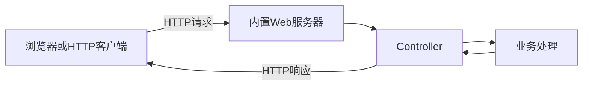

# Spring Boot 项目创建与 HTTP 请求响应

## 本篇快速复习

- 客户端发送 HTTP 请求，Spring 根据“请求方法 + URL”找到 Controller 方法，再返回 HTTP 响应。
- `@RestController` 把方法返回值写入响应体：Java 对象通常转成 JSON，`String` 通常是普通文本。
- `@RequestParam` 接收查询参数，`@PathVariable` 接收路径参数，`@RequestBody` 接收请求体。
- JSON 请求通常使用 `Content-Type: application/json`；普通表单常使用 `application/x-www-form-urlencoded`。
- REST 常用 `GET` 查询、`POST` 新增、`PUT` 完整修改、`PATCH` 部分修改、`DELETE` 删除。
- `/api/users` 是 JSON 数据接口；`/` 可以打开 HTML，再由 JavaScript 获取 JSON 并渲染。
- HTTP 响应包括状态码、响应头和响应体；`ResponseEntity` 可以控制三者。
- 浏览器地址栏适合测试简单 GET；JSON POST、PUT 等请求可用 IDEA HTTP Client、Postman 或 Apifox。

> [!info] 学习环境
> 本篇以 JDK 21、Spring Boot 4.0.7、Maven 和用户列表案例为例。

---

## 1. 一次请求的整体流程

**结论：请求从客户端进入 Controller，方法返回值再成为响应。**



以 `GET /hello` 为例：

1. 客户端访问 `http://localhost:8080/hello`；
2. 内置服务器接收请求；
3. Spring 找到匹配的 Controller 方法；
4. 方法执行并返回字符串或对象；
5. Spring 写入响应体，对象通常被序列化为 JSON；
6. 客户端收到状态码、响应头和响应体。

---

## 2. 创建并启动项目

**结论：使用 Spring Initializr 创建 Maven 项目，选择 JDK 21 和 Spring Web 即可开始。**

在 IDEA 中选择 `New Project → Spring Initializr`，主要设置：

```text
Language     Java
Type         Maven
JDK          21
Spring Boot  4.0.7
Dependency   Spring Web
```

若 IDEA 中没有合适入口，也可以从 [Spring Initializr](https://start.spring.io/) 生成后打开。

主要目录：

```text
demo
├─ pom.xml
└─ src
   ├─ main
   │  ├─ java/com/example/demo
   │  │  └─ DemoApplication.java
   │  └─ resources
   │     ├─ application.yaml
   │     └─ static
   └─ test
```

启动类：

```java
@SpringBootApplication
public class DemoApplication {

    public static void main(String[] args) {
        SpringApplication.run(DemoApplication.class, args);
    }
}
```

控制台出现类似信息表示启动成功：

```text
Tomcat started on port 8080
Started DemoApplication
```

默认地址是 `http://localhost:8080`。刚创建时没有 `/` 接口或静态首页，访问根地址出现 404 不代表启动失败。

修改端口：

```yaml
server:
  port: 8081
```

---

## 3. 创建第一个接口

**结论：`@GetMapping` 描述请求，`@RestController` 表示返回值直接进入响应体。**

```java
@RestController
public class HelloController {

    @GetMapping("/hello")
    public String hello() {
        return "Hello Spring Boot";
    }
}
```

访问：

```text
http://localhost:8080/hello
```

会得到普通文本：

```text
Hello Spring Boot
```

### `@RestController` 的准确含义

它可以简单理解为：

```text
@Controller + @ResponseBody
```

- 返回 Java 对象：通常由 JSON 转换器序列化为 JSON；
- 返回 `String`：通常直接返回普通文本；
- 它不负责生成漂亮的 HTML 页面。

### `@RequestMapping` 与快捷注解

```java
@RestController
@RequestMapping("/api/users")
public class UserController {

    @GetMapping
    public List<User> list() {
        return List.of();
    }
}
```

完整地址为 `GET /api/users`。

常用快捷注解：

```text
@GetMapping
@PostMapping
@PutMapping
@PatchMapping
@DeleteMapping
```

---

## 4. HTTP 请求由什么组成

**结论：一个请求主要包含请求方法、URL、请求头和请求体。**

```http
POST /api/users HTTP/1.1
Host: localhost:8080
Content-Type: application/json

{
  "name": "小明",
  "age": 20
}
```

> [!warning] 请求头和请求体之间要空一行
> 在 `.http` 文件中不要把注释放在这条空行内。

### 4.1 常用请求方法

| 方法 | REST 常见用途 | 示例 |
|---|---|---|
| `GET` | 查询 | 查询员工 |
| `POST` | 新增 | 新增员工 |
| `PUT` | 完整修改 | 替换员工主要信息 |
| `PATCH` | 部分修改 | 只修改工资 |
| `DELETE` | 删除 | 删除员工 |

`PUT` 和 `PATCH` 的区别是接口设计约定，Spring 不会自动决定修改哪些字段，最终仍由 Java 代码和 SQL 实现。

### 4.2 URL

```text
http://localhost:8080/api/users/10?detail=true
│      │         │    │               │
协议   主机名     端口  路径            查询参数
```

### 4.3 请求头

常见请求头：

```http
Content-Type: application/json
Authorization: Bearer token值
```

获取请求头：

```java
@GetMapping("/token")
public String token(
        @RequestHeader("Authorization") String authorization) {
    return authorization;
}
```

### 4.4 常见请求体格式

| `Content-Type` | 内容形式 | Spring 常见接收方式 |
|---|---|---|
| `application/json` | JSON | `@RequestBody` |
| `application/x-www-form-urlencoded` | `name=小明&age=20` | `@RequestParam` 或对象绑定 |
| `multipart/form-data` | 表单和文件 | `MultipartFile` |

发送 JSON 时应设置：

```http
Content-Type: application/json
```

---

## 5. Spring 接收三种请求参数

**结论：先判断数据位于查询字符串、URL 路径还是请求体，再选择注解。**

### 5.1 `@RequestParam`：查询参数

请求：

```text
GET /api/users?name=小明
```

```java
@GetMapping
public String search(
        @RequestParam("name") String name) {
    return "查询：" + name;
}
```

可选参数和默认值：

```java
@RequestParam(
        name = "pageNum",
        defaultValue = "1"
) Integer pageNum
```

### 5.2 `@PathVariable`：路径参数

请求：

```text
GET /api/users/10
```

```java
@GetMapping("/{id}")
public String getById(
        @PathVariable("id") Long id) {
    return "查询用户：" + id;
}
```

### 5.3 `@RequestBody`：JSON 请求体

```java
@PostMapping
public User add(@RequestBody User user) {
    return user;
}
```

请求：

```http
POST http://localhost:8080/api/users
Content-Type: application/json

{
  "name": "小明",
  "age": 20
}
```

Spring 会把 JSON 字段转换到 Java 对象属性。

### 三种参数对照

| 注解 | 数据位置 | 示例 |
|---|---|---|
| `@RequestParam` | URL 查询字符串 | `/users?name=小明` |
| `@PathVariable` | URL 路径 | `/users/10` |
| `@RequestBody` | 请求体 | JSON 对象 |

同一个方法可以组合使用，例如路径中的 id 加请求体中的修改内容。

> [!note] 普通表单和文件
> `application/x-www-form-urlencoded` 的字段既可以逐个使用 `@RequestParam`，也可以通过 Spring MVC 数据绑定到一个普通 Java 对象，此时不要加 `@RequestBody`。上传文件通常使用 `multipart/form-data`，并用 `MultipartFile` 配合 `@RequestParam` 或 `@RequestPart` 接收。

---

## 6. HTTP 响应

**结论：响应主要包含状态码、响应头和响应体。**

```http
HTTP/1.1 200 OK
Content-Type: application/json

{
  "id": 10,
  "name": "小明"
}
```

常见状态码：

| 状态码 | 含义 |
|---|---|
| `200 OK` | 请求成功 |
| `201 Created` | 创建成功 |
| `204 No Content` | 成功但没有响应体 |
| `400 Bad Request` | 参数或请求格式有误 |
| `401 Unauthorized` | 未完成认证 |
| `403 Forbidden` | 已识别身份但无权限 |
| `404 Not Found` | 资源或接口不存在 |
| `500 Internal Server Error` | 服务器内部异常 |

### 返回对象与 `ResponseEntity`

直接返回对象时，通常得到 JSON：

```java
@GetMapping("/{id}")
public User getById(@PathVariable("id") Long id) {
    return userService.getById(id);
}
```

需要控制状态码时：

```java
@PostMapping
public ResponseEntity<User> add(@RequestBody User user) {
    User saved = userService.add(user);
    return ResponseEntity.status(201).body(saved);
}
```

---

## 7. JSON 接口与 HTML 页面

**结论：后端接口提供数据，HTML 页面通过 JavaScript 获取数据并渲染。**

两个地址作用不同：

```text
http://localhost:8080/             打开HTML页面
http://localhost:8080/api/users    返回JSON数据
```

静态页面放在：

```text
src/main/resources/static/index.html
```

最小渲染示例：

```html
<table>
  <tbody id="userBody"></tbody>
</table>

<script>
  fetch('/api/users')
    .then(response => response.json())
    .then(users => {
      document.querySelector('#userBody').innerHTML = users
        .map(user => `<tr><td>${user.name}</td></tr>`)
        .join('');
    });
</script>
```

> [!warning] 直接访问 API 看到 JSON 是正常的
> `/api/users` 面向前端代码或接口客户端；浏览器要看到表格，应访问 HTML 页面。

`@Controller` 常用于模板页面，返回的字符串可能被解释为视图名称；`@RestController` 则把字符串或对象直接写入响应体。

---

## 8. REST 用户接口示例

**结论：同一资源使用统一 URL，通过 HTTP 方法表达不同操作。**

```java
@RestController
@RequestMapping("/api/users")
public class UserController {

    private final UserService userService;

    public UserController(UserService userService) {
        this.userService = userService;
    }

    @GetMapping("/{id}")
    public User get(@PathVariable("id") Long id) {
        return userService.getById(id);
    }

    @GetMapping
    public List<User> list(
            @RequestParam(value = "name", required = false)
            String name) {
        return userService.list(name);
    }

    @PostMapping
    public ResponseEntity<User> add(@RequestBody User user) {
        return ResponseEntity.status(201)
                .body(userService.add(user));
    }

    @PutMapping("/{id}")
    public User update(
            @PathVariable("id") Long id,
            @RequestBody User user) {
        return userService.update(id, user);
    }

    @DeleteMapping("/{id}")
    public ResponseEntity<Void> delete(
            @PathVariable("id") Long id) {
        userService.delete(id);
        return ResponseEntity.noContent().build();
    }
}
```

| 功能 | 请求 |
|---|---|
| 查询一个 | `GET /api/users/10` |
| 条件查询 | `GET /api/users?name=小明` |
| 新增 | `POST /api/users` |
| 修改 | `PUT /api/users/10` |
| 删除 | `DELETE /api/users/10` |

---

## 9. 测试接口

**结论：浏览器适合简单 GET，`.http` 文件适合完整接口请求。**

```http
### 查询
GET http://localhost:8080/api/users/10

### 新增
POST http://localhost:8080/api/users
Content-Type: application/json

{
  "name": "小明",
  "age": 20
}

### 删除
DELETE http://localhost:8080/api/users/10
```

点击 IDEA 中请求左侧运行按钮即可发送。也可以使用 Postman、Apifox 或自动化测试。

---

## 10. 常见问题

**结论：先根据状态码判断问题位于路径、方法、参数格式还是服务器代码。**

| 现象 | 常见原因 |
|---|---|
| `404` | URL 错误、Controller 未扫描、资源不存在 |
| `405` | 请求方法不匹配，例如用 GET 调 POST 接口 |
| `400` | 缺参数、JSON 错误、类型转换失败 |
| `415` | `Content-Type` 不匹配，例如 JSON 未声明类型 |
| `500` | 服务器代码异常，需要查看控制台日志 |
| 端口占用 | 关闭占用进程或修改 `server.port` |

### 问：不传时间参数会自动使用当前时间吗？

不会。没传时通常是 `null`。需要在 Service 中调用 `LocalDateTime.now()`，或设置数据库默认值。

### 问：可以使用 `toString()` 返回完整对象吗？

不推荐。`toString()` 是普通文本，不是结构化 JSON。直接返回 Java 对象，Spring 才能按字段序列化。

### 问：为什么统一响应中的 `data` 是 `null`？

检查调用的是不是无参数方法：

```java
Result.success();      // 通常data为null
Result.success(emp);   // data中包含emp
```

还要确认 `success(data)` 实现确实把参数赋给了 `data` 字段。

---

## 11. 核心速记

```text
@RestController  返回值写入响应体
@RequestMapping  设置统一路径或完整映射条件
@GetMapping      处理GET
@PostMapping     处理POST
@PutMapping      处理PUT
@DeleteMapping   处理DELETE
@RequestParam    查询参数
@PathVariable    路径参数
@RequestBody     JSON请求体
@RequestHeader   请求头
ResponseEntity   控制状态码、响应头和响应体
```

> URL 和请求方法决定执行哪个 Controller 方法；参数进入方法，返回值经过处理后成为 HTTP 响应。

---

## 继续学习

- [[2、Spring三层架构、内聚与耦合、IoC与DI]]
- [[4、SpringBoot配置文件与日志]]
- [[5、Web接口工程化基础：DTO、校验、异常与跨域]]
- [[0、SpringBoot笔记目录与学习路线|返回笔记目录]]
