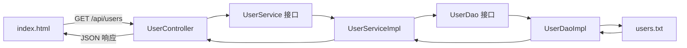

> 配套案例：浏览器请求用户列表，后端读取 `users.txt`，返回 JSON，前端渲染表格。

---

## 1. 案例整体流程

本案例包含以下内容：

- `index.html`：发送 HTTP 请求并渲染用户表格。
- `UserController`：接收 `/api/users` 请求。
- `UserService`：定义用户业务。
- `UserServiceImpl`：实现用户业务。
- `UserDao`：定义用户数据访问方式。
- `UserDaoImpl`：读取并解析 `users.txt`。
- `User`：表示一个用户对象。

完整调用流程：



浏览器访问的两个地址作用不同：

```text
http://localhost:8080/             前端 HTML 页面
http://localhost:8080/api/users    后端 JSON 接口
```

> **注意：** 直接访问 `/api/users` 时看到 JSON 是正常现象。HTML 页面会通过 `fetch("/api/users")` 获取 JSON，再将其渲染成表格。

---

## 2. 为什么要使用三层架构

如果把所有代码都写在 Controller 中，Controller 可能同时负责：

1. 接收 HTTP 请求。
2. 读取 `users.txt`。
3. 解析字符串。
4. 创建 `User` 对象。
5. 过滤或排序用户。
6. 返回 JSON。

随着功能增加，一个方法会越来越长，也会越来越难修改和测试。

三层架构将这些工作分开：

| 层 | 主要职责 | 本案例中的工作 |
|---|---|---|
| Controller | 接收请求、返回响应 | 接收 `/api/users`，调用 Service |
| Service | 处理业务逻辑 | 查询、过滤、排序用户 |
| Dao/Repository | 访问数据 | 读取和解析 `users.txt` |

一句话记忆：

> **Controller 管请求，Service 管业务，Dao 管数据。**

---

## 3. Controller 层

Controller 是 Web 层入口，负责：

- 接收 HTTP 请求。
- 获取路径参数、查询参数或请求体。
- 进行基础参数校验。
- 调用 Service。
- 返回 JSON 或页面。

示例：

```java
@RestController
@RequestMapping("/api/users")
public class UserController {
	// 构造器注入
    private final UserService userService;

    public UserController(UserService userService) {
        this.userService = userService;
    }

    @GetMapping
    public List<User> getUsers() {
        return userService.findAll();
    }
}
```

Controller 不应该：

- 直接读取 `users.txt`。（数据层）
- 直接连接数据库。（数据层）
- 编写大量业务判断。（业务处理层）
- 使用 `new UserServiceImpl()` 创建 Service。（耦合）

> **注意：** Controller 应依赖 `UserService` 接口，而不是直接依赖 `UserServiceImpl`。

---

## 4. Service 层

Service 层负责业务规则，例如：

- 判断用户是否存在。
- 过滤未成年用户。
- 按编号或年龄排序。
- 检查邮箱是否重复。
- 决定用户能否新增或删除。

Service 接口：

```java
public interface UserService {

    List<User> findAll();
}
```

Service 实现：

```java
@Service
public class UserServiceImpl implements UserService {
	// 构造器注入
    private final UserDao userDao;

    public UserServiceImpl(UserDao userDao) {
        this.userDao = userDao;
    }

    @Override
    public List<User> findAll() {
        return userDao.findAll()
                .stream()
                .sorted(Comparator.comparing(User::getId))
                .toList();
    }
}
```

这里的排序属于业务处理，因此放在 Service 比放在 Dao 更合适。

> **注意：** Service 不应该知道用户数据在 txt、MySQL 还是其他系统中。它只需要通过 `UserDao` 接口取得数据。

---

## 5. Dao 数据访问层

Dao 是 `Data Access Object`，即数据访问对象。

Dao 负责：

- 读取文件或查询数据库。
- 将底层数据转换为 Java 对象。
- 保存、修改或删除数据。
- 隐藏具体的数据存储方式。

Dao 接口：

```java
public interface UserDao {

    List<User> findAll();
}
```

txt 实现：

```java
@Repository
public class TxtUserDaoImpl implements UserDao {

    @Override
    public List<User> findAll() {
        InputStream inputStream = getClass()
                .getClassLoader()
                .getResourceAsStream("users.txt");

        if (inputStream == null) {
            throw new IllegalStateException("找不到 users.txt 文件");
        }

        List<String> lines = IoUtil.readLines(
                inputStream,
                StandardCharsets.UTF_8,
                new ArrayList<>()
        );

        return lines.stream()
                .filter(line -> !line.isBlank())
                .map(this::parseUser)
                .toList();
    }

    private User parseUser(String line) {
        String[] parts = line.split(",");

        if (parts.length != 4) {
            throw new IllegalArgumentException(
                    "用户数据格式错误：" + line
            );
        }

        return new User(
                Integer.valueOf(parts[0].trim()),
                parts[1].trim(),
                Integer.valueOf(parts[2].trim()),
                parts[3].trim()
        );
    }
}
```

### 为什么 Dao 应返回 `List<User>`

不推荐：

```java
List<String> txtToList();
```

这种设计会让 Service 知道：

- 数据来自 txt。
- 每行使用逗号分隔。
- 每个位置分别代表什么字段。

推荐：

```java
List<User> findAll();
```

Dao 负责读取和解析，Service 只接收业务对象。这样更换数据源时，Service 不需要跟着修改。

---

## 6. 什么是高内聚

内聚描述的是：

> **一个类内部的代码是否都在围绕同一种职责工作。**

高内聚的例子：

- `UserController` 中都是请求和响应代码。
- `UserServiceImpl` 中都是用户业务规则。
- `TxtUserDaoImpl` 中都是 txt 用户数据访问代码。

低内聚的例子：

```java
public class UserServiceImpl {

    // 读取文件
    // 解析字符串
    // 判断业务规则
    // 设置 HTTP 响应头
    // 生成 HTML
}
```

这个类承担了太多不同种类的工作，因此内聚性较低。

> **注意：** 高内聚不是“类越小越好”。如果把打开文件、读取一行、字符串分割全部拆成独立类，可能造成过度设计。

---

## 7. 什么是低耦合

耦合描述的是：

> **一个类对其他类的了解和依赖程度。**

强耦合：

```java
List<User> users = new UserDaoImpl().findAll();
```

问题：

- Service 直接依赖具体的 `UserDaoImpl`。
- 更换 MySQL 实现时必须修改 Service。
- 无法方便地使用模拟 Dao 进行测试。（test 测试）
- 对象创建不再由 Spring 管理。（使用了 new）

低耦合：

```java
// 构造器注入
private final UserDao userDao;

public UserServiceImpl(UserDao userDao) {
    this.userDao = userDao;
}
```

Service 只依赖 `UserDao` 接口，不关心具体实现。

如果把 txt 换成 MySQL，可以新增：

```java
@Repository
public class MysqlUserDaoImpl implements UserDao {

    @Override
    public List<User> findAll() {
        // 查询 MySQL
        return List.of();
    }
}
```

Controller 和 Service 的业务代码通常不需要修改。

---

## 8. 分层解耦的核心方法

### 8.1 每一层只负责自己的工作

```text
Controller → HTTP
Service    → 业务
Dao        → 数据
```

### 8.2 上层依赖接口

推荐：

```java
private final UserService userService;
private final UserDao userDao;
```

不推荐：

```java
private final UserServiceImpl userServiceImpl;
private final UserDaoImpl userDaoImpl;
```

### 8.3 不手动创建下层对象

不推荐：

```java
UserDao userDao = new UserDaoImpl();
```

推荐让 Spring 注入：

```java
public UserServiceImpl(UserDao userDao) {
    this.userDao = userDao;
}
```

### 8.4 不让底层细节泄漏到上层

如果 Dao 返回 `List<String>`，Service 就必须理解 txt 格式。

如果 Dao 返回 `List<User>`，Service 只需要处理用户业务。

---

## 9. IoC：控制反转

IoC 是 `Inversion of Control`，中文是“控制反转”。

### 传统方式

对象由程序员手动创建：

```java
UserDao userDao = new UserDaoImpl();
UserService userService = new UserServiceImpl(userDao);
UserController controller = new UserController(userService);
```

此时，对象创建权在业务代码中。

### Spring IoC 方式（各种注解）

```java
@Repository
public class UserDaoImpl implements UserDao {
}
```

```java
@Service
public class UserServiceImpl implements UserService {
}
```

```java
@RestController
public class UserController {
}
```

Spring 启动时负责：

1. 扫描组件。
2. 创建对象。
3. 将对象放入 IoC 容器。
4. 分析对象之间的依赖。
5. 注入需要的对象。

控制权从业务代码转移给 Spring，所以称为“控制反转”。

> **IoC 的重点：对象由谁创建、由谁管理。**

---

## 10. Spring Bean 与 IoC 容器

被 Spring 创建并管理的对象称为 Bean。

例如：

```java
@Service
public class UserServiceImpl {
}
```

`UserServiceImpl` 的对象就是一个 Spring Bean。

Spring 常用组件注解：

| 注解 | 典型位置 | 含义 |
|---|---|---|
| `@Component` | 通用组件 | 将类注册为 Bean |
| `@Service` | Service 层 | 业务组件 |
| `@Repository` | Dao 层 | 数据访问组件 |
| `@Controller` | MVC 控制器 | 返回页面 |
| `@RestController` | REST 控制器 | 返回 JSON 等响应体 |

@Component              根注解
    ├── @Controller     MVC 控制器
    │       └── @RestController   REST 控制器
    ├── @Service        业务逻辑层
    ├── @Repository     数据访问层
    └── @Configuration  配置类
这些注解本质上都能让 Spring 管理对应对象。

> **注意：** `@Service` 本身已经具有 `@Component` 的作用，不需要同时写 `@Service` 和 `@Component`。以此类推。

### 组件扫描范围

<font color="#00b0f0">问题：使用前面学习的几个注解声明的 bean，一定会生效吗？​</font>
<font color="#00b0f0">答案：不一定。（原因：bean 想要生效，还需要被组件扫描）</font>

`@SpringBootApplication` 默认扫描启动类所在包及其子包。

例如启动类位于：

```text
org.example.hellospring
```

那么下面的包可以被扫描：

```text
org.example.hellospring.user.controller
org.example.hellospring.user.service
org.example.hellospring.user.dao
```

> **注意：** 如果组件类放在启动类包之外，可能无法被默认扫描。
> 所以，建议严格按照下面的包格式进行规范架构。

---

## 11. DI：依赖注入

DI 是 `Dependency Injection`，中文是“依赖注入”。

假设 `UserServiceImpl` 需要 `UserDao`：

```java
@Service
public class UserServiceImpl implements UserService {

    private final UserDao userDao;

    public UserServiceImpl(UserDao userDao) {
        this.userDao = userDao;
    }
}
```

Spring 会：

1. 找到实现 `UserDao` 的 Bean。
2. 创建 `UserServiceImpl`。
3. 将 `UserDao` Bean 作为构造参数传入。

可以将其理解为 Spring 自动完成了：

```java
UserDao userDao = 从IoC容器中找到的对象;
UserServiceImpl service = new UserServiceImpl(userDao);
```

> **DI 的重点：对象需要的依赖如何传入。**

IoC 和 DI 的关系：

```text
IoC：Spring 管理对象
DI：Spring 将对象之间的依赖连接起来
```

DI 是实现 IoC 的主要方式之一。

---

## 12. `@Autowired` 的作用

`@Autowired` 表示让 Spring 自动注入依赖。

构造器注入：

```java
@Autowired
public UserServiceImpl(UserDao userDao) {
    this.userDao = userDao;
}
```

如果类只有一个构造器，可以省略 `@Autowired`：

```java
public UserServiceImpl(UserDao userDao) {
    this.userDao = userDao;
}
```

Spring 仍然会使用这个构造器完成注入。

> **特别注意：Spring 可以自动调用唯一构造器，但不会自动生成一个不存在的 Java 构造器。**

下面的代码会编译失败：

```java
@Service
public class UserServiceImpl {

    private final UserDao userDao;
}
```

因为 `final` 字段没有完成初始化。

如果字段不是 `final`：

```java
private UserDao userDao;
```

代码可能可以编译，但如果没有构造器注入或字段注入，它的值就是 `null`，调用时会出现 `NullPointerException`。

---

## 13. 为什么推荐构造器注入

推荐：

```java
private final UserDao userDao;

public UserServiceImpl(UserDao userDao) {
    this.userDao = userDao;
}
```

不推荐字段注入：

```java
@Autowired
private UserDao userDao;
```

构造器注入的优点：

- 依赖关系清晰。
- 字段可以声明为 `final`。
- 对象创建完成后，依赖一定存在。
- 更方便编写单元测试。
- 不依赖反射给私有字段赋值。
- 可以及时发现循环依赖。

---

## 14. Lombok 构造器注入

如果项目使用 Lombok，可以写：

```java
@Service
@RequiredArgsConstructor
public class UserServiceImpl implements UserService {

    private final UserDao userDao;
}
```

Lombok 会在编译期间生成：

```java
public UserServiceImpl(UserDao userDao) {
    this.userDao = userDao;
}
```

> **注意：** 这是 Lombok 生成的构造器，不是 Spring 生成的。没有 `@RequiredArgsConstructor` 时，Spring不会凭空生成构造器。

---

## 15. 多个实现类时如何注入

假设有两个实现：

```java
@Repository
public class TxtUserDaoImpl implements UserDao {
}
```

```java
@Repository
public class MysqlUserDaoImpl implements UserDao {
}
```

Spring 会发现两个 `UserDao` Bean，无法确定注入哪一个。

### 使用 `@Primary`

```java
@Primary
@Repository
public class TxtUserDaoImpl implements UserDao {
}
```

表示默认优先使用该实现。

### 使用 `@Qualifier`

```java
public UserServiceImpl(
        @Qualifier("txtUserDaoImpl") UserDao userDao) {
    this.userDao = userDao;
}
```

表示明确指定 Bean 名称。

> **注意：** 只有一个实现类时，不需要使用 `@Primary` 或 `@Qualifier`。

### 使用 `@Resource`

`@Resource(name = "...")` 可以明确按 Bean 名称注入；未显式指定 `name` 时，Spring 通常先按默认名称查找，找不到时再尝试按类型匹配。​

```java 
@RestController​
public class UserController {​
	@Resource(name = "userServiceImpl")​
	private UserService userService;​
```

<font color="#e36c09">​面试题：@Autowired 与 @Resource 的区别​</font>
<font color="#e36c09">@Autowired 是 spring 框架提供的注解，而@Resource 是 JDK 提供的注解​</font>
<font color="#e36c09">@Autowired 默认是按照类型注入，而@Resource 是按照名称注入</font>

---

## 16. 推荐的项目结构

```text
src/main/java/org/example/hellospring
├─ HelloSpringApplication.java
└─ user
   ├─ controller
   │  └─ UserController.java
   ├─ service
   │  ├─ UserService.java
   │  └─ impl
   │     └─ UserServiceImpl.java
   ├─ dao
   │  ├─ UserDao.java
   │  └─ impl
   │     └─ TxtUserDaoImpl.java
   └─ model
      └─ User.java

src/main/resources
├─ application.properties
├─ users.txt
└─ static
   └─ index.html
```

Java 包名使用全小写：

```text
controller
service
dao
model
```

不推荐：

```text
Controller
Service
Dao
```

> **注意：** Windows 文件系统通常不区分大小写，但 Linux 区分。遵守全小写包名规范可以减少部署问题。

---

## 17. 正确的核心代码骨架

### `UserDao`

```java
public interface UserDao {

    List<User> findAll();
}
```

### `TxtUserDaoImpl`

```java
@Repository
public class TxtUserDaoImpl implements UserDao {

    @Override
    public List<User> findAll() {
        // 读取并解析 users.txt
        return users;
    }
}
```

### `UserService`

```java
public interface UserService {

    List<User> findAll();
}
```

### `UserServiceImpl`

```java
@Service
public class UserServiceImpl implements UserService {

    private final UserDao userDao;

    public UserServiceImpl(UserDao userDao) {
        this.userDao = userDao;
    }

    @Override
    public List<User> findAll() {
        return userDao.findAll();
    }
}
```

### `UserController`

```java
@RestController
@RequestMapping("/api/users")
public class UserController {

    private final UserService userService;

    public UserController(UserService userService) {
        this.userService = userService;
    }

    @GetMapping
    public List<User> getUsers() {
        return userService.findAll();
    }
}
```

---

## 18. 常见误区

### 误区一：定义了接口就一定是低耦合

虽然定义了 `UserDao`，但如果仍然写：

```java
new UserDaoImpl();
```

代码依然依赖具体实现，不是真正的低耦合。

### 误区二：`@Autowired` 会生成构造器

不会。`@Autowired` 只告诉 Spring 使用哪个注入点，不负责生成 Java 代码。

### 误区三：删除构造器后 Spring 会自动补上

Spring 只会自动使用已经存在的唯一构造器，不会创建源代码中不存在的构造器。

### 误区四：`@Service` 和 `@Component` 要一起使用

不需要：

```java
@Service
@Component
public class UserServiceImpl {
}
```

只保留：

```java
@Service
public class UserServiceImpl {
}
```

### 误区五：Dao 只负责读取字节或字符串

数据层通常还负责将底层数据映射为领域对象。让 Dao 返回 `List<User>`，可以避免 txt 格式泄漏到 Service。

### 误区六：所有方法都写 `throws Exception`

`Exception` 范围太宽，会让上层无法判断具体错误。

更合适的方式包括：

- 使用更具体的异常。
- 在 Dao 内转换为自定义数据访问异常。
- 使用全局异常处理器统一返回错误响应。

### 误区七：分层越多越好

三层架构是为了降低复杂度，不是为了增加类的数量。小型学习案例不需要把每一行操作都拆成接口。

---

## 19. 如何判断是否实现高内聚、低耦合

可以通过“修改影响范围”进行判断。

### 场景一：txt 换成 MySQL

理想情况：

- 主要新增或修改 Dao 实现。
- Service 不关心数据源。
- Controller 不需要修改。
- HTML 不需要修改。

### 场景二：增加“只展示成年人”

理想情况：

- 修改 Service 业务逻辑。
- Dao 仍然负责返回用户数据。
- Controller 不需要修改。

### 场景三：接口地址发生变化

理想情况：

- 修改 Controller 映射。
- Service 和 Dao 不需要修改。
- 前端请求地址需要同步调整。

如果一个小需求导致 Controller、Service、Dao 全部修改，说明职责或抽象边界可能不合理。

---

## 20. 正式项目还可以继续改进

### 使用 DTO 隔离前端和内部模型

不直接返回 `User`，而是返回：

```java
public record UserResponse(
        Integer id,
        String name,
        Integer age,
        String email
) {
}
```

这样内部 `User` 增加密码等字段时，不会意外返回给前端。

### 使用统一响应结构

```json
{
  "code": 200,
  "message": "操作成功",
  "data": []
}
```

### 使用全局异常处理

通过 `@RestControllerAdvice` 统一处理业务异常和数据异常，避免每个 Controller 重复编写错误响应。

> **学习建议：** 先掌握三层职责、接口依赖和构造器注入，再学习 DTO、统一响应和全局异常处理。

---

## 21. 核心知识点对照

| 知识点 | 核心问题 | 本案例中的体现 |
|---|---|---|
| 三层架构 | 代码如何分工 | Controller、Service、Dao |
| 高内聚 | 一个类是否只做一类工作 | Dao 只管数据，Service 只管业务 |
| 低耦合 | 类是否依赖具体实现 | 依赖 `UserDao` 而不是 `UserDaoImpl` |
| IoC | 对象由谁创建和管理 | Spring 容器创建各层 Bean |
| DI | 依赖对象如何传入 | 构造器注入 |
| Bean | 什么对象被 Spring 管理 | 带组件注解的类实例 |
| `@Component` | 注册通用 Bean | 普通 Spring 组件 |
| `@Service` | 注册业务 Bean | `UserServiceImpl` |
| `@Repository` | 注册数据访问 Bean | `TxtUserDaoImpl` |
| `@RestController` | 注册 REST 控制器 | `UserController` |
| `@Autowired` | 指定自动注入 | 单构造器时可以省略 |

---

## 22. 最终自检清单

在完成分层后，可以逐项检查：

- [ ] Controller 是否只处理请求和响应？
- [ ] Service 是否主要处理业务规则？
- [ ] Dao 是否隐藏了具体数据源和数据格式？
- [ ] Controller 是否依赖 Service 接口？
- [ ] Service 是否依赖 Dao 接口？
- [ ] 是否还存在 `new UserServiceImpl()` 或 `new UserDaoImpl()`？
- [ ] 实现类是否使用了正确的 Spring 组件注解？
- [ ] 是否重复使用了 `@Service` 和 `@Component`？
- [ ] 是否优先采用构造器注入？
- [ ] 单构造器省略 `@Autowired` 时，构造器本身是否仍然存在？
- [ ] Dao 是否返回 `User`，而不是向 Service 暴露 txt 原始字符串？
- [ ] 是否避免随意声明 `throws Exception`？
- [ ] Java 包名是否全部使用小写？
- [ ] 更换数据源时，Controller 和业务代码是否基本不受影响？

---

## 23. 一句话总结

> 三层架构通过 Controller、Service、Dao 分离请求、业务和数据职责；高内聚要求每一层专注自己的工作，低耦合要求上层依赖接口而不是具体实现；IoC 将对象创建权交给 Spring，DI 则由 Spring 将各层需要的依赖通过构造器注入，从而让代码更容易替换、测试和维护。


---

## 继续学习

- [[3、MyBatis知识点总结]]
- [[5、Web接口工程化基础：DTO、校验、异常与跨域]]

- [[0、SpringBoot笔记目录与学习路线|返回笔记目录]]
