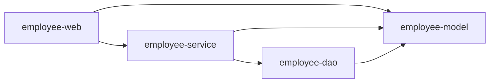

# Spring 三层架构、内聚与耦合、IoC 与 DI

## 本篇快速复习

- 三层架构可以记成：Controller 管请求，Service 管业务，Dao/Mapper 管数据。
- 高内聚要求一个类围绕一种职责工作；低耦合要求减少对具体实现和底层细节的依赖。
- Dao 是数据访问层概念；在 MyBatis 项目中，Mapper 是这一层的主要实现形式。
- 接口有利于隔离实现，但不是所有只有一个简单实现的 Service 都必须强制创建接口。
- IoC 表示对象创建和管理交给 Spring；DI 表示 Spring 把对象需要的依赖传进去。
- `@Component`、`@Service` 等用于注册组件；`@Service` 通常放在实现类，不放在普通接口。
- 推荐构造器注入。只有一个构造器时可省略 `@Autowired`，但 Spring 只会调用已有构造器，不会生成构造器。
- `@RequiredArgsConstructor` 是 Lombok 在编译期生成构造器，不是 Spring 生成。
- 多个同类型 Bean 可用 `@Primary` 或 `@Qualifier` 选择；`@Resource` 来自 `jakarta.annotation`。
- 当前项目用 web、service、dao、model 四个 Maven 模块进一步约束分层依赖。

> [!info] 配套案例
> HTML 请求用户列表，后端读取 `users.txt`，返回 JSON，前端将其渲染成表格；随后再映射到当前 MyBatis 员工管理项目。

---

## 1. 用户列表案例调用链

**结论：页面、请求处理、业务规则和数据读取分别交给不同组件。**


主要文件：

| 文件或类 | 作用 |
|---|---|
| `index.html` | 请求接口并渲染表格 |
| `UserController` | 接收 `/api/users` 请求 |
| `UserServiceImpl` | 查询、过滤或排序用户 |
| `TxtUserDaoImpl` | 读取并解析 `users.txt` |
| `User` | 表示用户数据 |

两个地址作用不同：

```text
http://localhost:8080/             HTML页面
http://localhost:8080/api/users    JSON接口
```

直接访问 `/api/users` 看到 JSON 是正常的。JSON 与 HTML 的关系详见 [[1、SpringBoot项目创建与HTTP请求响应]]。

---

## 2. 为什么要使用三层架构

**结论：分层把不同种类的变化隔开，避免一个 Controller 同时处理所有工作。**

如果一个方法同时负责：

```text
接收请求 → 读文件 → 解析字符串 → 判断规则 → 生成响应
```

功能增加后会很难修改和测试。

三层分工：

| 层 | 主要职责 | 本案例 |
|---|---|---|
| Controller | 接收参数、调用 Service、返回响应 | 处理 `/api/users` |
| Service | 业务规则和事务边界 | 查询、过滤、排序 |
| Dao/Mapper | 访问数据并完成映射 | 读取 txt 或执行 SQL |

一句话记忆：

> Controller 管请求，Service 管业务，Dao/Mapper 管数据。

### Controller 不应该做什么

- 直接读取文件或执行 SQL；
- 编写大量业务判断；
- 使用 `new UserServiceImpl()` 创建下层对象。

### Service 不应该做什么

- 处理 HTTP 响应头或 HTML；
- 知道 txt 的逗号格式；
- 依赖 Controller。

### Dao/Mapper 不应该做什么

- 决定用户是否有业务删除权限；
- 返回 HTTP 状态码；
- 反向调用 Service。

> [!warning] 分层不是绝对按代码行划分
> 参数格式校验常放在 Web 边界，业务规则放 Service，数据库字段映射放 Dao/Mapper。判断依据是“这段代码属于哪种职责”。

---

## 3. 一套最小代码骨架

**结论：Controller 调 Service，Service 调 Dao，具体数据源隐藏在 Dao 实现中。**

### 数据对象

```java
public class User {
    private Integer id;
    private String name;
    private Integer age;
    private String email;

    // 构造器、getter、setter省略
}
```

### Dao

```java
public interface UserDao {
    List<User> findAll();
}
```

```java
@Repository
public class TxtUserDaoImpl implements UserDao {

    @Override
    public List<User> findAll() {
        // 读取users.txt，将每行解析为User
        // 这里用空列表占位，实际实现见文件读取代码
        return List.of();
    }
}
```

Dao 应返回 `List<User>`，而不是 `List<String>`。否则 Service 还要知道文件分隔符和字段位置，底层格式就泄漏到了业务层。

### Service

```java
public interface UserService {
    List<User> findAll();
}
```

```java
@Service
public class UserServiceImpl implements UserService {

    private final UserDao userDao;

    public UserServiceImpl(UserDao userDao) {
        this.userDao = userDao;
    }

    @Override
    public List<User> findAll() {
        return userDao.findAll().stream()
                .sorted(Comparator.comparing(User::getId))
                .toList();
    }
}
```

排序是业务要求，所以放在 Service。`Stream.toList()` 返回的列表不可直接增删；后续确实需要修改时，应创建可变副本。

### Controller

```java
@RestController
@RequestMapping("/api/users")
public class UserController {

    private final UserService userService;

    public UserController(UserService userService) {
        this.userService = userService;
    }

    @GetMapping
    public List<User> list() {
        return userService.findAll();
    }
}
```

---

## 4. Dao、Mapper 与 Repository 的关系

**结论：Dao/Repository 表示数据访问职责，Mapper 是 MyBatis 项目中的具体技术形式。**

在 txt 案例中，需要自己编写：

```text
UserDao接口 + TxtUserDaoImpl实现
```

在 MyBatis 项目中，通常编写：

```java
public interface EmpMapper {
    Emp getById(Integer id);
}
```

再通过 `@Mapper` 或启动类中的：

```java
@MapperScan("com.tanhong.mapper")
```

让 MyBatis 创建 Mapper 代理 Bean。因此：

```text
Dao/Repository：数据访问层的概念
Mapper：当前项目实现数据访问层的主要方式
```

> [!warning] Mapper 接口是特殊接口
> 普通接口不能自己产生对象；Mapper 能注入，是因为 MyBatis 创建了代理实现，不是 Spring 凭空实例化接口。

---

## 5. 高内聚与低耦合

**结论：高内聚看“一个类内部是否专注”，低耦合看“类之间是否知道得太多”。**

### 5.1 高内聚

高内聚示例：

```text
UserController   都是请求响应代码
UserServiceImpl  都是用户业务规则
TxtUserDaoImpl   都是txt数据访问代码
```

低内聚示例：一个 Service 同时读取文件、解析字符串、设置响应头并生成 HTML。

高内聚不是类越小越好。把每一行代码都拆成一个类，会变成过度设计。

### 5.2 低耦合

强耦合：

```java
UserDao userDao = new TxtUserDaoImpl();
```

Service 直接知道具体实现，更换 MySQL 数据源时必须修改 Service。

低耦合：

```java
private final UserDao userDao;

public UserServiceImpl(UserDao userDao) {
    this.userDao = userDao;
}
```

Service 依赖数据访问能力，不负责创建具体对象。

### 接口不是唯一标准

接口适合：

- 存在多个实现；
- 需要明确模块契约；
- 实现容易变化；
- 测试时希望替换实现。

只有一个很简单且稳定的 Service 时，直接注入实现类也可以。低耦合还取决于职责、依赖方向和是否泄漏底层细节，不能只靠“创建了接口”判断。

### 用修改影响范围检查设计

| 变化 | 理想修改位置 |
|---|---|
| txt 换成 MySQL | Dao/Mapper 为主 |
| 增加“只显示成年人” | Service 为主 |
| URL 改为 `/api/employees` | Controller 和前端请求地址 |

如果一个小需求总要同时修改所有层，说明职责边界可能不合理。

---

## 6. IoC、Bean 与组件扫描

**结论：IoC 把对象创建和管理的控制权从业务代码交给 Spring。**

传统方式：

```java
UserDao dao = new TxtUserDaoImpl();
UserService service = new UserServiceImpl(dao);
UserController controller = new UserController(service);
```

使用 Spring 后，通过组件注解描述对象：

```java
@Repository
public class TxtUserDaoImpl implements UserDao {
}

@Service
public class UserServiceImpl implements UserService {
}

@RestController
public class UserController {
}
```

Spring 启动时会扫描、创建、保存并连接这些对象。被 Spring 管理的对象称为 Bean。

| 注解 | 典型位置 |
|---|---|
| `@Component` | 通用组件 |
| `@Service` | 业务实现类 |
| `@Repository` | 数据访问实现类 |
| `@Controller` | MVC Controller |
| `@RestController` | REST Controller |
| `@Configuration` | 配置类 |

这些注解都具有组件含义。`@Service` 已经能注册 Bean，不要再重复添加 `@Component`。

### 组件扫描范围

`@SpringBootApplication` 默认扫描启动类所在包及其子包。启动类应尽量放在根包：

```text
com.tanhong.EmployeeManagementApplication
```

这样 `com.tanhong.controller`、`com.tanhong.service` 等子包都能被发现。

Bean 作用域、第三方 Bean 和 `@Import` 详见 [[10、Bean进阶：作用域、第三方Bean与Import]]。

---

## 7. DI、`@Autowired` 与构造器

**结论：DI 是 Spring 把 Bean 需要的依赖传入，推荐使用构造器注入。**

```java
@Service
public class UserServiceImpl implements UserService {

    private final UserDao userDao;

    public UserServiceImpl(UserDao userDao) {
        this.userDao = userDao;
    }
}
```

构造器注入的优点：

- 必要依赖清晰；
- 字段可使用 `final`；
- 创建后依赖完整；
- 便于单元测试；
- 更容易发现循环依赖。

### `@Autowired` 是什么

`@Autowired` 告诉 Spring 在指定位置注入依赖。类只有一个构造器时可以省略：

```java
public UserServiceImpl(UserDao userDao) {
    this.userDao = userDao;
}
```

必须准确理解：

> Spring 可以自动调用已经存在的唯一构造器，但不会生成不存在的 Java 构造器。

下面代码没有其他构造器生成工具时会编译失败：

```java
private final UserDao userDao;
```

因为 `final` 字段没有初始化。

字段注入虽然短，但不推荐作为主要写法：

```java
@Autowired
private UserDao userDao;
```

它隐藏依赖关系，字段无法方便地保持 `final`，测试时也更难直接传入替代对象。

### Lombok 构造器

```java
@Service
@RequiredArgsConstructor
public class UserServiceImpl implements UserService {
    private final UserDao userDao;
}
```

Lombok 在编译期生成：

```java
public UserServiceImpl(UserDao userDao) {
    this.userDao = userDao;
}
```

删除手写构造器仍能运行，通常是因为 Lombok 已经生成，而不是 Spring 自动补上。

---

## 8. 多个实现怎样选择

**结论：一个接口有多个 Bean 时，要明确默认实现或在注入点指定。**

假设同时有：

```text
TxtUserDaoImpl
MysqlUserDaoImpl
```

### `@Primary`

```java
@Primary
@Repository
public class MysqlUserDaoImpl implements UserDao {
}
```

表示默认优先使用它。

### `@Qualifier`

```java
public UserServiceImpl(
        @Qualifier("txtUserDaoImpl") UserDao userDao) {
    this.userDao = userDao;
}
```

表示在这个位置明确选择 Bean 名称。

### `@Resource`

```java
import jakarta.annotation.Resource;

@Resource(name = "txtUserDaoImpl")
private UserDao userDao;
```

`@Resource` 来自 Jakarta Annotation API，不是 Spring 注解，也不能简单说成 JDK 21 自带。显式写 `name` 时按名称选择很清楚；未写名称时 Spring 还有名称和类型匹配规则。

> [!note] 推荐顺序
> 仍优先使用构造器注入；需要区分多个实现时，在构造器参数上使用 `@Qualifier`。

---

## 9. 从 Java 包分层到 Maven 多模块

**结论：三层架构是职责思想，Java 包用于整理源码，Maven 模块进一步建立构建依赖边界。**

单模块可以按包组织：

```text
com.tanhong
├─ controller
├─ service
├─ mapper
└─ pojo
```

当前项目进一步拆成：

```text
employee-management
├─ employee-model
├─ employee-dao
├─ employee-service
└─ employee-web
```



| 模块 | 主要职责 |
|---|---|
| `employee-model` | 实体、查询参数、统一结果 |
| `employee-dao` | Mapper 接口和 XML |
| `employee-service` | 业务逻辑、事务、业务异常 |
| `employee-web` | Controller、安全、AOP、配置和页面 |

依赖方向应保持单向，Dao 不能反向依赖 Service。多模块细节见 [[12、Maven高级与多模块项目]]。

---

## 10. 重要误区与问答

**结论：分层和注入的价值在于职责及依赖关系，不在于注解和接口数量。**

### 误区：定义接口就一定低耦合

如果仍然写：

```java
new TxtUserDaoImpl();
```

代码依然依赖具体实现。反过来，简单 Service 只有一个稳定实现时，也不必机械地创建接口。

### 误区：`@Autowired` 会生成构造器

不会。它只声明注入点。唯一构造器可省略 `@Autowired`，构造器本身必须由源码或 Lombok 提供。

### 误区：`@Service` 和 `@Component` 要一起写

不需要。保留语义更明确的 `@Service` 即可。

### 误区：在业务接口上标 `@Service`

普通接口不能实例化，应标在实现类。MyBatis Mapper 能成为 Bean，是因为 MyBatis 创建了代理。

### 误区：分层越多越好

分层是为了降低复杂度。小功能无需为每个操作建立接口和实现类；出现清晰业务边界时再抽象。

### 问：为什么更换数据源时 Service 最好不改？

因为 Service 只处理 `User` 业务，不知道 txt 行格式或 SQL 细节。数据源变化应主要留在 Dao/Mapper。

### 问：为什么 Controller 不直接调用 Mapper？

这样会绕过业务规则和事务边界。功能简单时看似省代码，增长后容易让同一规则散落在多个 Controller。

### 问：什么时候不需要 Service 接口？

只有一个简单实现、没有替换需求且团队没有接口规范时，可以直接注入实现类。以后出现多实现或模块契约时再抽接口。

---

## 11. 正式项目还会增加什么

**结论：三层稳定后，再用 DTO、统一响应、校验和异常处理保护接口边界。**

- 请求 DTO：只接收接口允许的字段；
- 响应 DTO/VO：避免密码等内部字段泄漏；
- `Result<T>` 或 `ResponseEntity`：表达响应；
- `@Valid`：校验请求格式；
- `@RestControllerAdvice`：统一处理异常；
- `@Transactional`：保证一组数据库操作一致完成。

这些内容详见：

- [[5、Web接口工程化基础：DTO、校验、异常与跨域]]
- [[7、Spring事务与传播行为]]

---

## 12. 最终检查

**结论：通过“职责、依赖、创建方式、修改影响”四个方向检查分层质量。**

- [ ] Controller 是否主要处理请求和响应？
- [ ] Service 是否集中业务规则和事务边界？
- [ ] Dao/Mapper 是否隐藏数据源和映射细节？
- [ ] 是否还在业务代码中 `new` Service 或 Dao 实现？
- [ ] `@Service` 是否标在实现类而不是普通接口？
- [ ] 是否优先使用构造器注入？
- [ ] 省略手写构造器时，是否确实有 Lombok 生成？
- [ ] 多个实现是否使用 `@Primary` 或 `@Qualifier`？
- [ ] 更换数据源时，Controller 和业务规则是否基本不受影响？
- [ ] Maven 模块依赖是否保持单向？

---

## 一句话总结

> 三层架构分离请求、业务和数据职责；高内聚让每个类专注，低耦合减少对具体实现的了解；IoC 把对象交给 Spring 管理，DI 再通过已有构造器连接 Bean，从而让代码更容易替换、测试和维护。

---

## 继续学习

- [[3、MyBatis知识点总结]]
- [[5、Web接口工程化基础：DTO、校验、异常与跨域]]
- [[10、Bean进阶：作用域、第三方Bean与Import]]
- [[12、Maven高级与多模块项目]]
- [[0、SpringBoot笔记目录与学习路线|返回笔记目录]]
