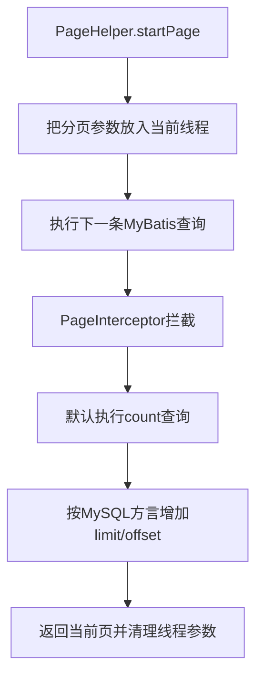

# 分页查询与 PageHelper

## 本篇快速复习

- 分页是在数据库中只查询当前页，不是先查询全部数据再用 Java 截取。
- MySQL 使用 `limit + offset`，`offset = (pageNum - 1) × pageSize`。
- `PageHelper.startPage()` 只设置参数，必须紧接需要分页的 MyBatis 查询。
- Mapper SQL 要有稳定的 `order by`，否则翻页可能重复或遗漏。
- `PageInfo` 要接收 Mapper 返回的原始分页 List，否则 `total` 可能丢失。
- 当前项目使用 Starter `4.1.1`、Core `6.1.1`，并开启 `reasonable: true`。
- 对外使用项目自己的 `PageResult<T>`，避免暴露 PageHelper 内部结构。

> 本篇先用 `User` 说明原理，再用当前 `employee-management` 的员工分页展示实际写法。

---

## 1. 分页原理

一次查询十万条数据会增加数据库、网络、Java 内存和前端渲染压力。分页请求通常包含：

```text
pageNum  当前页，从1开始
pageSize 每页条数
```

MySQL 示例：

```sql
select id, username, name
from user
order by id
limit 3 offset 3;
```

第 2 页、每页 3 条：

```text
offset = (2 - 1) × 3 = 3
```

> [!warning] 必须稳定排序
> 没有 `order by` 时数据库不保证返回顺序。排序字段不唯一时，建议再加主键，例如 `order by update_time desc, id desc`。

手写 MyBatis 分页需要两条查询：

```xml
<select id="findPage" resultType="com.tanhong.pojo.User">
    select id, username, name
    from user
    order by id
    limit #{pageSize} offset #{offset}
</select>

<select id="countAll" resultType="long">
    select count(*) from user
</select>
```

PageHelper 的价值就是统一处理分页 SQL 和总数查询。

---

## 2. 当前项目的依赖与配置

```text
pagehelper-spring-boot-starter  4.1.1
pagehelper core                 6.1.1
```

`employee-web` 引入 Starter，启动时注册分页拦截器；`employee-service` 因直接使用 `PageHelper/PageInfo`，依赖 Core API。版本由父 POM 统一管理。

```xml
<dependency>
    <groupId>com.github.pagehelper</groupId>
    <artifactId>pagehelper-spring-boot-starter</artifactId>
</dependency>
```

当前配置：

```yaml
pagehelper:
  helper-dialect: mysql
  reasonable: true
```

`reasonable: true` 会自动修正页码：

- `pageNum <= 0` 查询第一页。
- `pageNum` 超过总页数时查询最后一页。

> [!note] 自动修正不是必须
> 它适合学习项目，但也可能掩盖前端参数错误。正式接口也可以关闭它，并通过校验返回 `400 Bad Request`。

> [!danger] 不要叠加不同版本
> Starter 已包含传递依赖。发生冲突时用 `mvn dependency:tree` 检查，不要不断添加其他版本尝试。

---

## 3. PageHelper 怎样工作



核心结论：

1. `startPage` 本身不访问数据库。
2. PageHelper 默认只影响紧随其后的 MyBatis 查询。
3. 它是数据库物理分页，不是查询全部后调用 `subList()`。
4. 默认执行 `count`；不需要总数时可使用 `startPage(pageNum, pageSize, false)`，但此时没有准确 `total/pages`。

分页参数临时放在 `ThreadLocal` 中。插件在正常进入查询后会在 `finally` 清理；如果设置参数后根本没执行 Mapper 查询，参数可能残留并影响复用该线程的后续请求。

ThreadLocal 的完整原理见 [[9、Spring AOP、操作日志与ThreadLocal]]。

---

## 4. 当前员工分页写法

Mapper 保持普通动态查询，并在 SQL 末尾稳定排序：

```java
List<Emp> list(EmpQueryParam queryParam);
```

Service 负责开启分页：

```java
public PageResult<Emp> page(EmpQueryParam queryParam) {
    PageHelper.startPage(queryParam.getPageNum(), queryParam.getPageSize());

    // startPage后必须紧跟真正需要分页的MyBatis查询
    List<Emp> empList = empMapper.list(queryParam);

    // 直接使用Mapper返回的原始分页List
    PageInfo<Emp> pageInfo = new PageInfo<>(empList);

    return new PageResult<>(pageInfo.getTotal(), pageInfo.getList());
}
```

当前返回模型：

```java
@Data
@AllArgsConstructor
@NoArgsConstructor
public class PageResult<T> {
    private Long total;
    private List<T> list;
}
```

> [!important] 泛型不要省略
> 写 `new PageResult<>(...)`，不要写原始类型 `new PageResult(...)`。

---

## 5. `PageInfo` 与原始分页 List

```java
PageInfo<Emp> pageInfo = new PageInfo<>(empList);
```

常用信息：

| 字段 | 含义 |
|---|---|
| `list` | 当前页数据 |
| `pageNum/pageSize` | 当前页与每页条数 |
| `total` | 总记录数 |
| `pages` | 总页数 |
| `hasPreviousPage/hasNextPage` | 是否有前后页 |

> [!danger] 不要先复制或转换 List
> Mapper 返回值声明为 `List<Emp>`，实际通常是保存分页元数据的 `Page<Emp>`。若先 `stream().toList()` 或复制成 `ArrayList`，再构造 `PageInfo`，`total` 可能退化为当前页条数。应先构造 `PageInfo`，再转换 `pageInfo.getList()`。

---

## 6. Controller 参数

```java
@GetMapping("/api/users")
public PageResult<User> findPage(
        @RequestParam(defaultValue = "1") int pageNum,
        @RequestParam(defaultValue = "10") int pageSize) {
    return userService.findPage(pageNum, pageSize);
}
```

至少保证：

```text
pageNum >= 1
1 <= pageSize <= 100
```

限制 `pageSize` 可以防止客户端一次请求过多数据。当前员工项目把页码、条数和查询条件封装在 `EmpQueryParam` 中，由 Spring 自动绑定查询参数。

> [!warning] 当前源码现状
> `EmpQueryParam` 目前只有默认值，尚未真正限制 `pageSize`。`reasonable: true` 只修正页码，不能阻止超大页容量；正式使用前应在 Controller/DTO 用 `@Min/@Max` 校验，或在 Service 主动拒绝非法参数。

---

## 7. 安全调用与常见错误

如果存在“某个分支根本不执行查询”的情况，可以把分页范围写得更明确：

```java
return PageHelper
        .startPage(pageNum, pageSize)
        .doSelectPageInfo(() -> userMapper.findAll());
```

常见错误速查：

| 错误 | 结果/修正 |
|---|---|
| `startPage` 后先执行其他 Mapper 查询 | 其他查询被分页；目标查询不再分页 |
| 查询后才调用 `startPage` | 调用太晚，不会影响已经完成的查询 |
| SQL 没有 `order by` | 页间顺序不稳定 |
| 对结果再次 `subList()` | 重复分页，删除这一步 |
| 复杂联表直接 count | count 可能很慢或因一对多 JOIN 放大，需要检查生成 SQL |
| `limit 20 offset 100000` | 大偏移仍需跳过大量记录，可考虑游标分页 |

> [!danger] 一对多 JOIN 不宜直接分页父对象
> `limit` 在 MyBatis 用 `resultMap` 合并父子对象之前生效，可能出现一页员工不足或子集合被截断。常见方案是先分页查询员工主键/主表，再按这些 ID 查询工作经历并组装。

游标分页示例：

```sql
select id, username, name
from user
where id > #{lastId}
order by id
limit #{pageSize}
```

---

## 8. 多模块职责

| 模块 | 分页相关内容 |
|---|---|
| `employee-model` | `PageResult<T>`、`EmpQueryParam` |
| `employee-dao` | `EmpMapper.list()`、动态 SQL、`order by` |
| `employee-service` | `PageHelper`、`PageInfo` 调用 |
| `employee-web` | Controller、Starter 和自动配置 |

```text
employee-web → employee-service → employee-dao → employee-model
```

Service 编译时调用 Core API，Web 运行时负责创建数据源、MyBatis 环境和分页拦截器。

---

## 9. 一句话总结

> PageHelper 把当前线程中的分页参数应用到下一条 MyBatis 查询，默认生成 count 和分页 SQL；使用时要紧跟 Mapper 查询、稳定排序，并用原始分页 List 创建 `PageInfo`，再转换成项目自己的 `PageResult<T>`。

## 参考资料

- [PageHelper](https://github.com/pagehelper-org/Mybatis-PageHelper)
- [PageHelper Spring Boot Starter](https://github.com/pagehelper-org/pagehelper-spring-boot)

---

## 导航

- [[0、SpringBoot笔记目录与学习路线|返回笔记目录]]
- [[5、Web接口工程化基础：DTO、校验、异常与跨域|上一篇：Web 接口工程化基础]]
- [[7、Spring事务与传播行为|下一篇：Spring 事务与传播行为]]
- [[9、Spring AOP、操作日志与ThreadLocal|延伸：ThreadLocal]]
