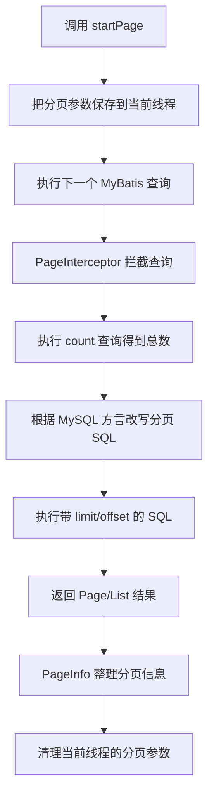

# 分页查询与 PageHelper

> 分页的目标是：一次只查询一部分数据，避免把整张用户表全部加载到内存和前端。

## 1. 为什么需要分页

假设用户表有 10 万条数据，如果一次全部查询：

- 数据库查询和网络传输变慢。
- Java 内存占用增加。
- 前端渲染卡顿。
- 用户也无法一次看完。

分页请求通常包含：

```text
pageNum  当前页，从 1 开始
pageSize 每页条数
```

例如：

```text
GET /api/users?pageNum=2&pageSize=3
```

表示查询第 2 页，每页 3 条。

## 2. MySQL 分页原理

MySQL 常用：

```sql
select id, username, name, age
from user
order by id
limit 3 offset 3;
```

计算公式：

```text
offset = (pageNum - 1) × pageSize
```

第 2 页、每页 3 条：

```text
offset = (2 - 1) × 3 = 3
```

也就是跳过前 3 条，再取 3 条。

> [!warning] 必须排序
> 分页查询应使用稳定的 `order by`，通常按主键排序。没有排序时，数据库不保证每次返回顺序一致，可能出现重复或遗漏。

## 3. 手写 MyBatis 分页

Mapper：

```java
List<User> findPage(
        @Param("offset") int offset,
        @Param("pageSize") int pageSize
);

long countAll();
```

XML：

```xml
<select id="findPage" resultType="com.tanhong.pojo.User">
    select id, username, name, age
    from user
    order by id
    limit #{pageSize} offset #{offset}
</select>

<select id="countAll" resultType="long">
    select count(*) from user
</select>
```

优点是 SQL 和执行过程直观；缺点是每个分页查询都要处理 `limit`、`offset` 和总数查询。

## 4. PageHelper 是什么

PageHelper 是 MyBatis 的分页插件。它会拦截紧随其后的查询，并根据数据库类型改写 SQL。

Maven 依赖示例（`4.1.1` 是当前官方 README 的示例版本，依赖版本更新后应以官方说明为准）：

```xml
<dependency>
    <groupId>com.github.pagehelper</groupId>
    <artifactId>pagehelper-spring-boot-starter</artifactId>
    <version>4.1.1</version>
</dependency>
```

> [!warning] 当前项目注意
> 当前项目已经显式使用 Spring Boot 4.x 和 `mybatis-spring-boot-starter` 4.x。加入 PageHelper Starter 前，应先查看该版本的官方兼容说明；加入后执行 `mvn dependency:tree`，确认没有混用不兼容的 MyBatis、MyBatis-Spring 或 Starter 版本。若发生冲突，先统一版本，不要继续叠加依赖尝试。

## 5. 最基本的使用方式

Mapper 保持普通查询：

```java
List<User> findAll();
```

XML 必须提供稳定排序：

```xml
<select id="findAll" resultType="com.tanhong.pojo.User">
    select id, username, name, age
    from user
    order by id
</select>
```

Service：

```java
public PageInfo<User> findPage(int pageNum, int pageSize) {
    PageHelper.startPage(pageNum, pageSize);
    List<User> users = userMapper.findAll();
    return new PageInfo<>(users);
}
```

调用顺序非常重要：

```text
PageHelper.startPage(...)
紧接着执行 Mapper 查询
```

## 6. PageHelper 内部做了什么



核心理解：

1. `startPage` 本身不查询数据库。
2. 它先把页码和每页条数保存到 `ThreadLocal`。
3. MyBatis 执行下一条查询时，`PageInterceptor` 进行拦截。
4. 插件通常先查询总数，再改写原 SQL。
5. MySQL 分页 SQL最终包含 `limit` 和 `offset`。
6. 查询结束后插件清理线程中的分页状态。

因此 PageHelper 是数据库物理分页，不是先查出全部数据再用 Java 截取。

## 7. `PageInfo` 中常用字段

```java
PageInfo<User> pageInfo = new PageInfo<>(users);
```

常见字段：

| 字段 | 含义 |
|---|---|
| `list` | 当前页数据 |
| `pageNum` | 当前页码 |
| `pageSize` | 每页条数 |
| `total` | 总记录数 |
| `pages` | 总页数 |
| `hasPreviousPage` | 是否有上一页 |
| `hasNextPage` | 是否有下一页 |

典型 JSON：

```json
{
  "pageNum": 2,
  "pageSize": 3,
  "total": 10,
  "pages": 4,
  "list": [
    {"id": 4, "username": "user4", "name": "用户4", "age": 20}
  ]
}
```

正式接口可以只返回前端需要的分页字段，避免直接暴露 PageHelper 的全部内部字段。

## 8. Controller 示例

```java
@GetMapping("/api/users")
public PageInfo<User> findPage(
        @RequestParam(defaultValue = "1") int pageNum,
        @RequestParam(defaultValue = "10") int pageSize) {
    return userService.findPage(pageNum, pageSize);
}
```

建议限制参数范围：

```java
pageNum = Math.max(pageNum, 1);
pageSize = Math.min(Math.max(pageSize, 1), 100);
```

限制 `pageSize` 可以防止客户端传入极大数字，导致一次查询过多数据。

## 9. 更安全的调用方式

如果 `startPage` 后面的查询可能因为条件判断而不执行，分页参数可能影响同一线程后续查询。可以使用回调式 API，让分页范围更明确：

```java
public PageInfo<User> findPage(int pageNum, int pageSize) {
    return PageHelper
            .startPage(pageNum, pageSize)
            .doSelectPageInfo(userMapper::findAll);
}
```

这段代码明确表示：只对 `userMapper.findAll()` 进行分页。

## 10. 常见错误

### 错误一：`startPage` 后先执行了其他查询

```java
PageHelper.startPage(1, 10);
userMapper.countEnabled(); // 被分页的是这一条
userMapper.findAll();      // 这一条可能不再分页
```

PageHelper 默认只影响紧随其后的第一条 MyBatis 查询。

### 错误二：先查询再调用 `startPage`

```java
List<User> users = userMapper.findAll();
PageHelper.startPage(1, 10); // 已经晚了
```

### 错误三：没有 `order by`

翻页顺序可能不稳定。

### 错误四：在 Java 中对分页结果再次截取

PageHelper 已经完成数据库分页，不需要再用 `subList()`。

### 错误五：忽略 `count` 的成本

复杂联表查询的 `count(*)` 也可能很慢。若页面不需要总条数，可以考虑不查询总数，或设计“是否还有下一页”的返回方式。

### 错误六：大页码仍然很慢

```sql
limit 20 offset 100000
```

数据库仍需跳过大量记录。数据量很大时，可使用基于主键的游标分页：

```sql
select id, username, name, age
from user
where id > #{lastId}
order by id
limit #{pageSize}
```

## 11. PageHelper 与三层架构

| 层 | 分页职责 |
|---|---|
| Controller | 接收 `pageNum`、`pageSize`，限制参数范围 |
| Service | 开启 PageHelper，组织分页业务 |
| Mapper | 编写正常查询 SQL 和稳定排序 |
| PageHelper | 拦截并改写 SQL |
| 数据库 | 执行 `count` 和分页 SQL |

`PageHelper.startPage()` 通常放在 Service，而不是 Controller 或 Mapper XML 中。

## 12. 一句话总结

> 分页通过 `limit + offset` 只查询当前页；PageHelper 使用拦截器改写下一条 MyBatis 查询，并用 `PageInfo` 封装总数和页码等信息。使用时必须让 `startPage` 紧挨 Mapper 查询，并保证 SQL 有稳定的 `order by`。

## 参考资料

- [PageHelper](https://github.com/pagehelper-org/Mybatis-PageHelper)
- [PageHelper Spring Boot Starter](https://github.com/pagehelper-org/pagehelper-spring-boot)

---

## 导航

- [[0、SpringBoot笔记目录与学习路线|返回笔记目录]]
- [[5、Web接口工程化基础：DTO、校验、异常与跨域|上一篇：Web 接口工程化基础]]
