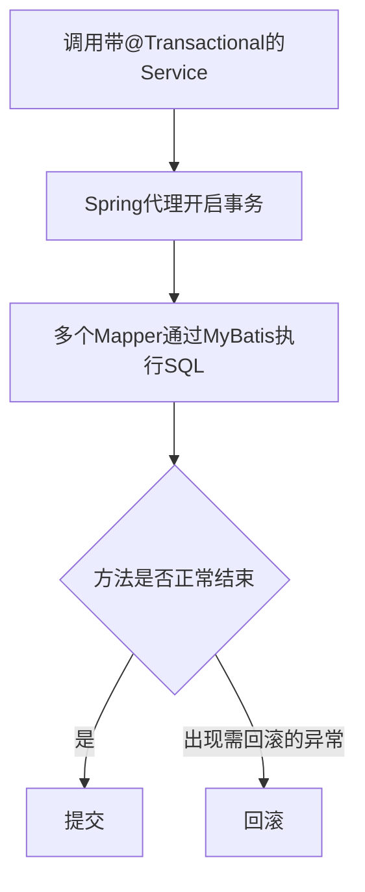
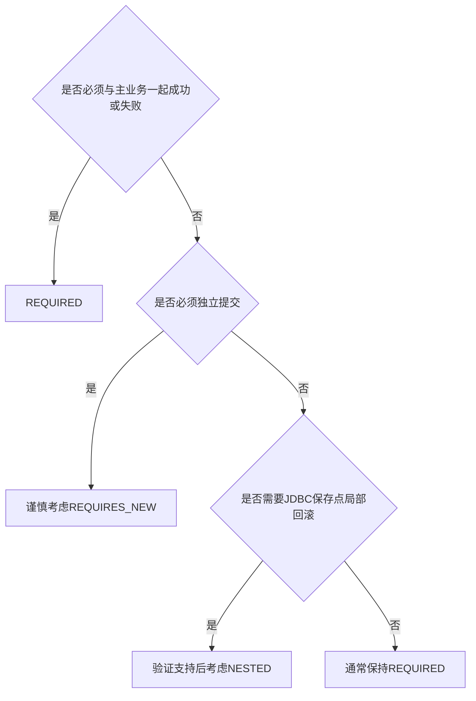

# Spring 事务与传播行为

## 本篇快速复习

- 事务保证一个业务中的多步数据库操作一起成功或一起失败。
- MyBatis 执行 SQL；Spring 开启、提交和回滚事务，并让多个 Mapper 共享事务连接。
- 事务通常放在 Service。当前员工、班级、学生写操作主要使用默认 `REQUIRED`。
- 默认遇到 `RuntimeException` 或 `Error` 回滚；检查型异常默认不回滚。
- `readOnly = true` 是只读提示，不是绝对写保护；写方法要用普通 `@Transactional` 覆盖。
- 事务依赖 Spring 代理，同类中的 `this.method()` 自调用不会经过代理。
- `REQUIRES_NEW` 是独立事务；`NESTED` 是同一物理事务中的保存点。

---

## 1. 事务与 ACID

新增员工需要：

```text
向 emp 插入基本信息
向 emp_expr 插入工作经历
```

如果第一步成功、第二步失败，数据库会留下不完整数据。事务保证：

```text
全部成功 → 提交
任意一步失败 → 全部回滚
```

ACID 四个特性：

| 特性 | 通俗理解 | 当前案例 |
|---|---|---|
| 原子性 Atomicity | 要么全做，要么全不做 | 员工与经历一起保存或回滚 |
| 一致性 Consistency | 前后都满足规则 | 不留下错误关联的数据 |
| 隔离性 Isolation | 并发事务尽量互不干扰 | 避免读到混乱的中间状态 |
| 持久性 Durability | 提交后能够持久保存 | 重启应用后数据仍在 |

> [!important] 事务与异常处理不同
> 事务决定数据库是否提交；全局异常处理器把异常转换成 HTTP 响应。异常通常只是触发回滚的信号。

---

## 2. Spring 与 MyBatis 怎样配合



| 组件 | 职责 |
|---|---|
| MyBatis/Mapper | 找映射、设参数、执行每条 SQL、封装结果 |
| Spring 事务管理器 | 开启、提交、回滚，管理事务连接 |
| MySQL | 真正修改数据并提供数据库事务能力 |

MyBatis 集成到 Spring 后，不需要手写 `connection.commit()` 或 `rollback()`。

> [!warning] 事务边界
> 相关 Mapper 必须使用同一个受 Spring 管理的数据源。新线程、远程服务或另一个数据库不会自动共享当前本地事务。

---

## 3. 什么时候加事务

重点考虑事务的情况：

1. 一个业务方法执行多条相关写 SQL。
2. 同时修改主表和子表。
3. 先查询判断，再修改数据，并要求过程保持一致。
4. 中途失败时，前面已经完成的修改必须撤销。

当前项目：

| 方法 | 相关操作 | 原因 |
|---|---|---|
| `EmpServiceImpl.save` | 新增员工、批量新增经历 | 两张表必须一起成功 |
| `EmpServiceImpl.update` | 更新员工、删除旧经历、插入新经历 | 全量覆盖不能只完成一半 |
| `EmpServiceImpl.deleteByIds` | 删除员工和经历 | 主表、子表保持一致 |
| `ClazzServiceImpl.deleteById` | 检查学生数量、删除班级 | 维护“有学生不能删除”规则 |

单条普通查询、纯 Java 计算通常不必专门开启读写事务；一条独立写 SQL 本身也具有单语句原子性。

> [!tip] 判断问题
> 假设方法执行到一半突然失败，保留前半部分数据库结果能否接受？不能接受，就需要事务。

> [!danger] 事务不能代替数据库约束
> 高并发下，“先查再写”仍可能发生竞争。外键、唯一索引等数据库约束是最后一道保护。存在外键且没有级联删除时，通常先删子表再删主表。

---

## 4. 当前项目的注解方式

```java
@Service
@Transactional(readOnly = true)
public class EmpServiceImpl implements EmpService {

    // 继承类上的只读事务
    public Emp getInfo(Integer id) {
        return empMapper.getById(id);
    }

    // 方法配置覆盖类配置，变成读写事务
    @Transactional
    public void save(Emp emp) {
        empMapper.insert(emp);

        List<EmpExpr> exprList = emp.getExprList();
        if (!CollectionUtils.isEmpty(exprList)) {
            exprList.forEach(expr -> expr.setEmpId(emp.getId()));
            empExprMapper.insertBatch(exprList);
        }
    }
}
```

方法注解优先于类注解：

```text
类：@Transactional(readOnly = true)
写方法：@Transactional
结果：写方法使用普通读写事务
```

> [!warning] `readOnly` 只是提示
> 底层可能据此优化，但它不是数据库权限，也不保证阻止所有写 SQL。写方法必须明确覆盖。

---

## 5. 默认规则、异常与回滚

普通 `@Transactional` 的关键默认值：

| 配置 | 默认值 |
|---|---|
| `propagation` | `REQUIRED` |
| `isolation` | `DEFAULT`，使用数据库默认隔离级别 |
| `readOnly` | `false` |
| 回滚 | `RuntimeException`、`Error` |

业务异常若继承 `RuntimeException`，默认触发回滚。检查型异常默认不回滚；确实需要时可写：

```java
@Transactional(rollbackFor = Exception.class)
public void importData() throws Exception {
    // ...
}
```

不要机械地给所有方法添加 `rollbackFor`，应先判断方法实际会抛出什么异常。

### 为什么 `catch` 后可能不回滚

```java
@Transactional
public void save(Emp emp) {
    empMapper.insert(emp);
    try {
        empExprMapper.insertBatch(emp.getExprList());
    } catch (Exception e) {
        log.warn("经历保存失败", e);
        // 异常被吞掉，方法正常结束，可能提交员工基本信息
    }
}
```

需要整体失败时，应继续抛出符合回滚规则的异常：

```java
catch (Exception e) {
    log.error("保存员工失败", e);
    throw new IllegalStateException("保存员工失败", e);
}
```

这里包装成运行时异常，默认可以触发回滚。如果必须原样抛出检查型异常，则方法需要声明 `throws`，并配置合适的 `rollbackFor`。

> [!important] 日志和返回值不会触发回滚
> `log.error()` 只记录信息；方法返回 `false` 也属于正常返回。通常用异常表达事务失败。

---

## 6. 代理与自调用失效

Spring 默认通过代理包住 Service：

```text
调用者 → Spring代理（开启事务）→ Service方法 → 代理（提交/回滚）
```

同类自调用绕过代理：

```java
@Service
public class EmpServiceImpl {
    public void outer() {
        this.inner(); // 没经过Spring代理
    }

    @Transactional
    public void inner() {
        // 事务可能不生效
    }
}
```

推荐把需要独立事务边界的方法放到另一个 Service Bean，再通过构造器注入调用。

常见生效条件：

- 类是 Spring 管理的 Bean，例如有 `@Service`。
- 调用经过 Spring 代理。
- 初学项目把事务方法保持为 `public`。
- 不依赖 `private` 方法或 `this.method()` 获得普通代理事务。
- 异常传播到代理边界并符合回滚规则。

> [!note] 怎样真正验证
> 事务失效不会阻止程序启动。应在第一条写 SQL 后主动制造异常，再检查数据库是否全部回滚。

---

## 7. 七种传播行为

传播行为回答：一个事务方法调用另一个事务方法时，内部方法如何处理现有事务？

| 行为 | 外部已有事务 | 外部没有事务 |
|---|---|---|
| `REQUIRED` | 加入 | 新建 |
| `REQUIRES_NEW` | 暂停外部，独立新建 | 新建 |
| `NESTED` | 在当前事务建立保存点 | 新建 |
| `SUPPORTS` | 加入 | 无事务运行 |
| `NOT_SUPPORTED` | 暂停外部 | 无事务运行 |
| `MANDATORY` | 加入 | 抛出异常 |
| `NEVER` | 抛出异常 | 无事务运行 |

> [!important] 当前项目
> 员工、班级和学生的主要写操作使用默认 `Propagation.REQUIRED`。不要为了“高级”而随意更换传播行为。

---

## 8. 三种重点传播行为

先假设“外层事务方法调用另一个 Bean 的内层事务方法”，并且内层抛出运行时异常：

| 行为 | 内层失败，外层捕获异常 | 内层成功后，外层又失败 | 新数据库连接 | 关键前提 |
|---|---|---|---|---|
| `REQUIRED` | 共同事务通常已标记回滚，外层不能正常提交 | 两部分一起回滚 | 否 | 默认选择 |
| `REQUIRES_NEW` | 内层单独回滚，外层可继续 | 内层已提交结果通常保留 | 是 | 必须经过代理，评估连接池 |
| `NESTED` | 可回滚到保存点，外层可选择继续 | 整个外层事务全部回滚 | 否 | 经过代理，且事务管理器支持保存点 |

> [!important] “可继续”不是自动继续
> 异常若一直向外抛，外层事务仍会失败。外层只有在业务允许时捕获内层异常，才可能继续；不能为了提交而随意吞掉异常。

### 8.1 `REQUIRED`：一起提交或回滚

```java
@Transactional // 默认就是Propagation.REQUIRED
public void save(Emp emp) {
    empMapper.insert(emp);
    // 另一个Bean中的REQUIRED方法会加入当前事务
}
```

- 外层没有事务：创建事务。
- 外层已有事务：加入同一个物理事务。

适合当前员工与经历等必须作为整体的业务。

> [!warning] `UnexpectedRollbackException`
> 内层 `REQUIRED` 失败后可能把共同事务标记为只能回滚。即使外层捕获异常继续执行，最终提交时仍可能得到该异常。

### 8.2 `REQUIRES_NEW`：独立事务

只有明确要求“主业务失败后，这项记录仍要独立保留”时才考虑：

```java
@Transactional(propagation = Propagation.REQUIRES_NEW)
public void saveIndependentLog(OperateLog log) {
    operateLogMapper.insert(log);
}
```

它暂停外层事务，获取连接并开启独立事务，完成后再恢复外层事务。

> [!danger] 连接池风险
> 外层占用一个连接，内层还要新连接。并发较高或连接池较小时可能耗尽连接；独立事务方法也必须通过另一个 Bean 的代理调用。

### 8.3 `NESTED`：保存点

```text
外层事务开始
  ├─ 完成步骤A
  ├─ 建立保存点
  ├─ 步骤B失败并回滚到保存点
  └─ 外层决定是否继续提交
```

| 对比 | `REQUIRES_NEW` | `NESTED` |
|---|---|---|
| 物理事务 | 独立事务 | 通常仍是外层事务 |
| 机制 | 暂停外层并新建 | JDBC Savepoint |
| 外层最终回滚 | 独立已提交结果通常保留 | 嵌套部分也会回滚 |

> [!warning] 支持限制
> `NESTED` 依赖数据库保存点和事务管理器支持，不能假定 JPA、分布式事务等环境都可用。

最小结构应放在两个 Bean 中，确保调用经过代理。下面的 `saveMainData()`、`savePart()` 代表省略的 Mapper 写操作：

```java
@Service
public class OuterService {
    private final NestedService nestedService;

    @Transactional
    public void process() {
        saveMainData();
        try {
            nestedService.saveOptionalPart();
        } catch (BusinessException exception) {
            // 只有业务允许放弃可选部分时，外层才继续
        }
    }
}

@Service
public class NestedService {
    @Transactional(propagation = Propagation.NESTED)
    public void saveOptionalPart() {
        savePart();
        throw new BusinessException("可选部分失败");
    }
}
```

内层代理会尝试回滚到保存点；若外层随后也抛出异常，主数据和嵌套部分仍会整体回滚。当前项目没有使用 `NESTED`，这只是帮助理解传播行为的示例。

---

## 9. 选择流程



```text
员工 + 工作经历            → REQUIRED
更新员工 + 全量替换经历     → REQUIRED
删除主表 + 子表             → REQUIRED
普通查询                    → readOnly=true或不显式声明
必须独立保留的记录          → 明确需求下考虑REQUIRES_NEW
```

---

## 10. 常见问答

### Q1：所有 Mapper 方法都要加事务吗？

不需要。事务表达完整业务，通常放在 Service；Mapper 只执行 SQL。

### Q2：全局异常处理器捕获异常，会妨碍回滚吗？

通常不会。异常先穿过 Service 事务代理，事务已经回滚，之后才由 Web 层转换响应。危险的是在事务方法内部提前捕获并吞掉。

### Q3：为什么给内部方法写 `REQUIRES_NEW` 却没有新事务？

先检查是否为 `this.inner()`。传播行为也依赖代理，推荐把独立事务方法放到另一个 Service Bean。

### Q4：“全删经历再新增”需要事务吗？

需要。它是全量覆盖方案，删除和重新插入必须一起成功；数据量大时可改为增量更新，但仍需事务。

### Q5：只看程序没有报错，能证明事务生效吗？

不能。应在中途主动抛出运行时异常，并检查前面执行的 SQL 是否回滚。

---

## 11. 自检清单

- [ ] 多条相关写 SQL 是否放在同一个 Service 事务？
- [ ] 写方法是否覆盖类上的 `readOnly = true`？
- [ ] 异常是否符合回滚规则并传播到事务代理？
- [ ] 是否捕获并吞掉了异常，或只返回 `false`？
- [ ] 是否存在 `this.method()` 导致事务、传播行为失效？
- [ ] 是否确实需要 `REQUIRES_NEW`，并评估连接池压力？
- [ ] 使用 `NESTED` 前是否验证保存点支持？
- [ ] 是否用“中途抛异常 + 检查数据库”验证回滚？
- [ ] 是否避免在事务中执行耗时网络请求或文件上传？

---

## 12. 一句话总结

> Spring 将一个 Service 业务中的多条 MyBatis SQL 组织为事务；当前项目主要使用默认 `REQUIRED` 保证关联修改一起提交或回滚，只有明确需要独立提交或保存点时才考虑 `REQUIRES_NEW/NESTED`。

## 参考资料

- [Spring Framework：使用 `@Transactional`](https://docs.spring.io/spring-framework/reference/data-access/transaction/declarative/annotations.html)
- [Spring Framework：事务传播行为](https://docs.spring.io/spring-framework/reference/data-access/transaction/declarative/tx-propagation.html)
- [MyBatis-Spring：Transactions](https://mybatis.org/spring/transactions.html)

---

## 导航

- [[0、SpringBoot笔记目录与学习路线|返回笔记目录]]
- [[3、MyBatis知识点总结|相关：MyBatis]]
- [[6、分页查询与PageHelper|上一篇：分页查询与 PageHelper]]
- [[8、登录认证与Spring Security：Session、Cookie、CSRF与BCrypt|下一篇：登录认证与 Spring Security]]
