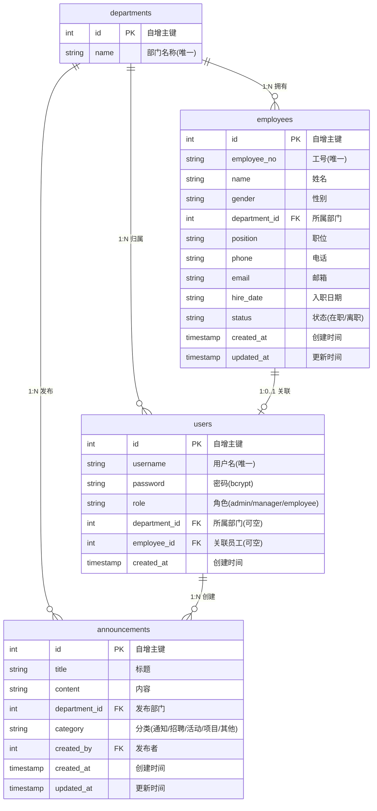

---
tags:
  - 数据库
  - ER图
  - 人力资源管理系统
created: 2026-06-07
---

# 人力资源管理系统 ER 图

## 关系说明

| 关系 | 基数 | 说明 |
|---|---|---|
| departments → employees | 1:N | 一个部门下有多名员工 |
| departments → users | 1:N | 一个部门下有多名用户(主管/员工) |
| departments → announcements | 1:N | 一个部门可发布多条公告 |
| employees → users | 1:0..1 | 员工可关联一个登录账号(可选,admin 无关联) |
| users → announcements | 1:N | 一个用户可发布多条公告 |

## 角色权限

| 角色 | 员工管理 | 公告中心 | 个人中心 |
|---|---|---|---|
| **admin** 系统管理员 | 全部 CRUD | 全部 CRUD | 查看 | 
| **manager** 部门主管 | 本部门 CRUD | 本部门 CRUD | 查看+编辑自联 | 
| **employee** 普通员工 | 无权限 | 仅查看 | 查看+编辑自联 | 
