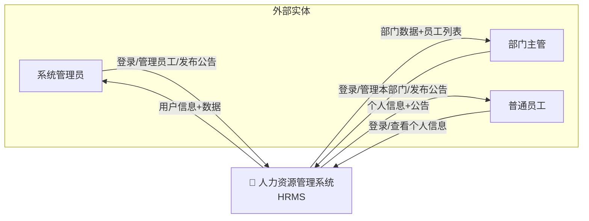

---
tags:
  - 数据流图
  - DFD
  - 人力资源管理系统
created: 2026-06-07
---

# 人力资源管理系统 数据流图

## Level 0 — 上下文图



## Level 1 — 一级分解

```mermaid
flowchart TB
    subgraph 客户端
        L[login.html\n登录页]
        I[index.html\n员工管理]
        F[employee-form.html\n员工表单]
        P[profile.html\n个人中心]
        N[announcements.html\n公告中心]
    end

    subgraph API层
        direction TB
        API1[P1 登录认证\nPOST /login\nPOST /logout\nGET /me]
        API2[P2 员工管理\nGET/POST /employees\nGET/PUT/DELETE /employees/{id}]
        API3[P3 公告管理\nGET/POST /announcements\nGET/PUT/DELETE /announcements/{id}]
        API4[P4 部门查询\nGET /departments]
    end

    subgraph 数据存储[H2 内嵌数据库]
        D1[(D1 departments\n部门表)]
        D2[(D2 employees\n员工表)]
        D3[(D3 users\n用户表)]
        D4[(D4 announcements\n公告表)]
    end

    L -->|用户名+密码| API1
    I -->|查询请求| API2
    I -->|查询请求| API4
    F -->|员工数据| API2
    F -->|查询请求| API4
    P -->|查询请求| API1
    P -->|个人信息| API2
    N -->|查询/发布/编辑| API3
    N -->|查询请求| API4

    API1 -->|验证| D3
    API2 -->|CRUD| D2
    API2 -->|关联查询| D1
    API3 -->|CRUD| D4
    API3 -->|关联查询| D1
    API3 -->|关联查询| D3
    API4 -->|列表查询| D1

    API1 -->|用户信息+Session| L
    API2 -->|员工列表/详情| I
    API2 -->|员工详情| P
    API3 -->|公告列表/详情| N
    API4 -->|部门列表| I
    API4 -->|部门列表| F
    API4 -->|部门列表| N
```

## 前端页面 ↔ API 映射

| 页面 | 调用 API | 数据流向 |
|---|---|---|
| **login.html** | `POST /api/login` | 前端 → API → users 表(验证) → 前端(Session) |
| **index.html** | `GET /api/employees` | H2 employees+departments → API → 前端(表格+统计) |
| | `GET /api/departments` | H2 departments → API → 前端(筛选下拉) |
| | `DELETE /api/employees/{id}` | 前端 → API → H2 employees(删除) |
| **employee-form.html** | `GET/POST /api/employees` | 前端 ⇄ API ⇄ H2 employees |
| | `GET /api/departments` | H2 departments → API → 前端(部门选择) |
| | `PUT /api/employees/{id}` | 前端 → API → H2 employees(更新) |
| **profile.html** | `GET /api/me` | API(session) → H2 users → 前端(用户信息) |
| | `GET /api/employees/{id}` | H2 employees → API → 前端(个人信息) |
| | `PUT /api/employees/{id}` | 前端(电话/邮箱) → API → H2 employees |
| **announcements.html** | `GET /api/announcements` | H2 announcements+departments+users → API → 前端 |
| | `POST /api/announcements` | 前端 → API → H2 announcements |
| | `PUT/DELETE /api/announcements/{id}` | 前端 → API → H2 announcements |

## 角色数据流

```mermaid
flowchart LR
    subgraph 角色
        Admin[系统管理员]
        Manager[部门主管]
        Employee[普通员工]
    end

    subgraph 权限过滤
        Auth[LoginInterceptor\nSession 校验 /api/**]
    end

    Admin -->|role=admin| Auth
    Manager -->|role=manager| Auth
    Employee -->|role=employee| Auth

    Auth -->|无Session| E401[返回 401\n"请先登录"]
    Auth -->|有Session| Gate{角色判断}

    Gate -->|admin| ALL[全部员工+全部公告\n全部CRUD]
    Gate -->|manager| DEPT[本部门员工+公告\n部门级CRUD]
    Gate -->|employee| SELF[仅个人信息\n仅查看公告]
```
