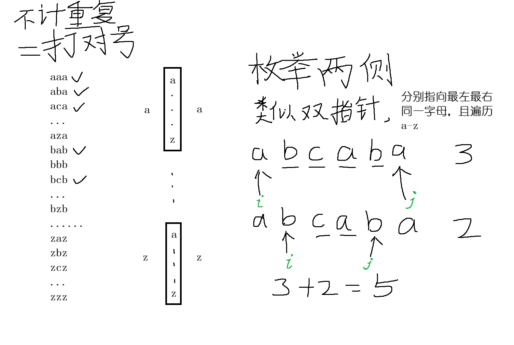
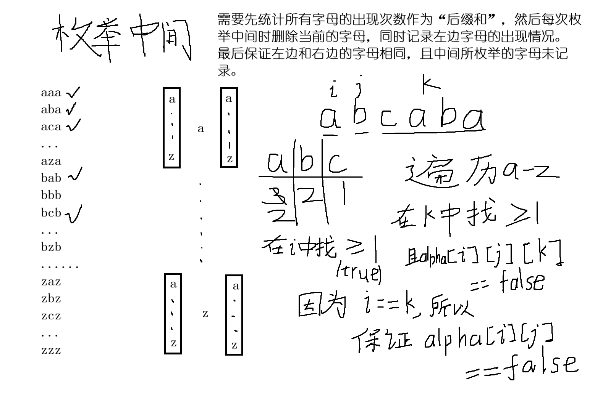

# [1930. 长度为 3 的不同回文子序列 ](https://leetcode.cn/problems/unique-length-3-palindromic-subsequences/description/)

给你一个字符串 `s` ，返回 `s` 中 **长度为 3** 的**不同回文子序列** 的个数。

<font color="#ffc000">即便存在多种方法来构建相同的子序列，但相同的子序列只计数一次。</font>

**回文** 是正着读和反着读一样的字符串，也就是关于中心轴左右对称。

**子序列** 是由原字符串删除其中部分字符（也可以不删除）且不改变剩余字符之间相对顺序形成的一个新字符串。

- 例如，`"ace"` 是 `"abcde"` 的一个子序列。

转化后问题：i j k → 枚举中间的 j，看左右的 i 和 k 对应的字母是否相等？并且不要重复统计序列。 


```cpp
class Solution {
public:
    int countPalindromicSubsequence(string s) {
        int ans = 0;

        // 枚举中间——a-z
        for(char c = 'a'; c <= 'z'; c++){
            // 左边第一个
            int i = s.find(c);
            // 字符串中没有这个字母,跳过 
            if(i == -1) continue;
            // 最右边的那个
            int j = s.rfind(c);

            //为了避免重复计数，可以用一个26字母表来标记记录过的字母
            bool alpha[26]{};
            for(int k = i + 1; k < j; k++){
                if(!alpha[s[k] - 'a']){
                    alpha[s[k] - 'a'] = true;
                    ans++;
                }
            }
        }

        return ans;

    }
};
```
这个思路是最清晰的，但不容易想到。




```cpp
class Solution {
public:
    int countPalindromicSubsequence(string s) {
        int ans = 0;

        int n = s.size();
        // 统计每个字母的出现次数,但因为第一个字母肯定要作为“前缀和”的内容，所以可以省去
        int rear_cnt[26]{};
        for(int k = 1; k < n; k++){
            rear_cnt[s[k] - 'a']++;
        }

        // “前缀和”记录，因为要避免重复统计，直接用bool类型表示
        bool prev_cnt[26]{};
        // 26字母表打对号
        bool alpha[26][26]{};
                
        // 枚举中间
        for(int j = 1; j < n - 1; j++){
            int mid = s[j] - 'a';
    		rear_cnt[mid]--; // 减去当前字母，始终代表“后缀和”
    		prev_cnt[s[j - 1] - 'a'] = true; // 记录前一个字母，始终代表后缀和
    
    		for(int c = 0; c < 26; c++){
        		// 确保左右都有相同的字母，且三个字母在字母表中没有打对号
        		if(prev_cnt[c] && rear_cnt[c] && !alpha[mid][c]){
            		alpha[mid][c] = true;
            		ans++;
        		}
    		}
		}

        return ans;

    }
};
```

我只想到可以先统计所有字母出现次数，然后枚举中间时删除当前的字母，并记录前面的字母，但要避免统计重复序列，这一步没想清楚，思考半天没思路。
总觉得左边的是一个数组，右边的也是一个数组，都需要遍历和判断，感觉很麻烦很奇怪。
实际只需要考虑是否存在，也就是 bool 类型。


<font color="#00b0f0">思考——如果不需要去重怎么实现？</font>


```cpp
	枚举中间 j，统计左右相同字符的组合数（乘法原理）
	
	// “后缀和”
	int suf_cnt[26]{};
	for (int i = 1; i < n; i++) {
    	suf_cnt[s[i] - 'a']++;
	}
	// “前缀和”
	int pre_cnt[26]{};
	long long ans = 0;

	for (int j = 1; j < n - 1; j++) {
    	int mid = s[j] - 'a';

    	// 把当前字符从右边移除
    	suf_cnt[mid]--;

    	// 枚举26个字母，乘法原理统计总数
    	for (int c = 0; c < 26; c++) {
       	 	ans += 1LL * pre_cnt[c] * suf_cnt[c];
    	}

    	// 把当前字符加入左边
    	pre_cnt[mid]++;
	}
	
	return ans;

```