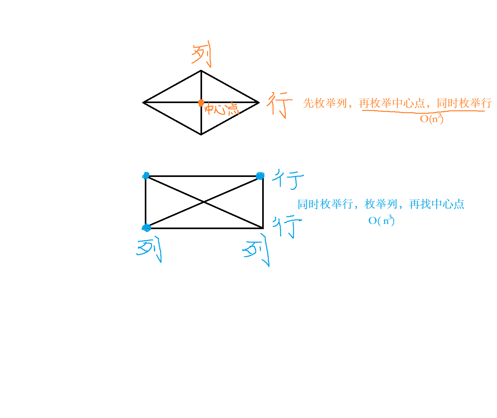

# [3128. 直角三角形](https://leetcode.cn/problems/right-triangles/description/)

给你一个二维 boolean 矩阵 `grid` 。

如果 `grid` 的 3 个元素的集合中，一个元素与另一个元素在 **同一行**，并且与第三个元素在 **同一列**，则该集合是一个 **直角三角形**。3 个元素 **不必** 彼此相邻。

请你返回使用 `grid` 中的 3 个元素可以构建的 **直角三角形** 数目，且满足 3 个元素值 **都** 为 1 。

题解如下：
套路：有三个顶点，枚举「**中间**」的直角顶点更容易计算。

想一想，直角顶点为 (i, j) 的「直角三角形」有多少个？
设第 i 行有 rowSum 个 1，第 j 列有 colSum 个 1。
根据**乘法原理**，直角顶点为 (i, j) 的「直角三角形」有 (rowSum − 1) * (colSum − 1) 个，加到答案中。

```cpp
class Solution {
public:
    long long numberOfRightTriangles(vector<vector<int>>& grid) {
    	// 每个 1 都可以作为直角点，  
		// 它能形成的三角形数量 =  同一行的其他 1 的个数 × 同一列的其他 1 的个数
        int n = grid[0].size();
        vector<int> col_sum(n, -1); // 提前减一
        for (auto& row : grid) {
            for (int j = 0; j < n; j++) {
            	// 把每一行第 j 列的值累加，从而得到第 j 列的总和（即 1 的个数）
                col_sum[j] += row[j];
            }
        }

        long long ans = 0;
        for (auto& row : grid) {
            int row_sum = reduce(row.begin(), row.end()) - 1; // 提前减一
            for (int j = 0; j < row.size(); j++) {
                if (row[j] == 1) {
                    ans += row_sum * col_sum[j];
                }
            }
        }
        return ans;
    }
};
```


这道题想了半天，我的大致思路是这样的：统计每一行"1"的个数再减一，之后遍历数组暴力判断上下两行对应索引的值是否为 1，如果是，ans += 这两行"1"的总个数-2，也就是上面统计的内容。但判断这个部分太复杂了。

我的思路其实是在：枚举行 → 枚举列 → 再找第三个点  （知识点中的枚举左，暴力）
题解思路是：枚举“中心点”（知识点中的枚举中间，充分利用历史信息）


这是一个非常经典的模型：
“枚举中心点 + 两边计数”
类似结构还有：
- 十字交叉计数
- 子矩阵计数
- 图中“以某点为中心”的组合

看到类似：
点 / 网格 / 分层 / 平行 / 同一行 / 同一列
优先想：
分组 → 每组做组合 → 组间再组合

类似思路的题目：
[3623. 统计梯形的数目 I ](https://leetcode.cn/problems/count-number-of-trapezoids-i/description/)